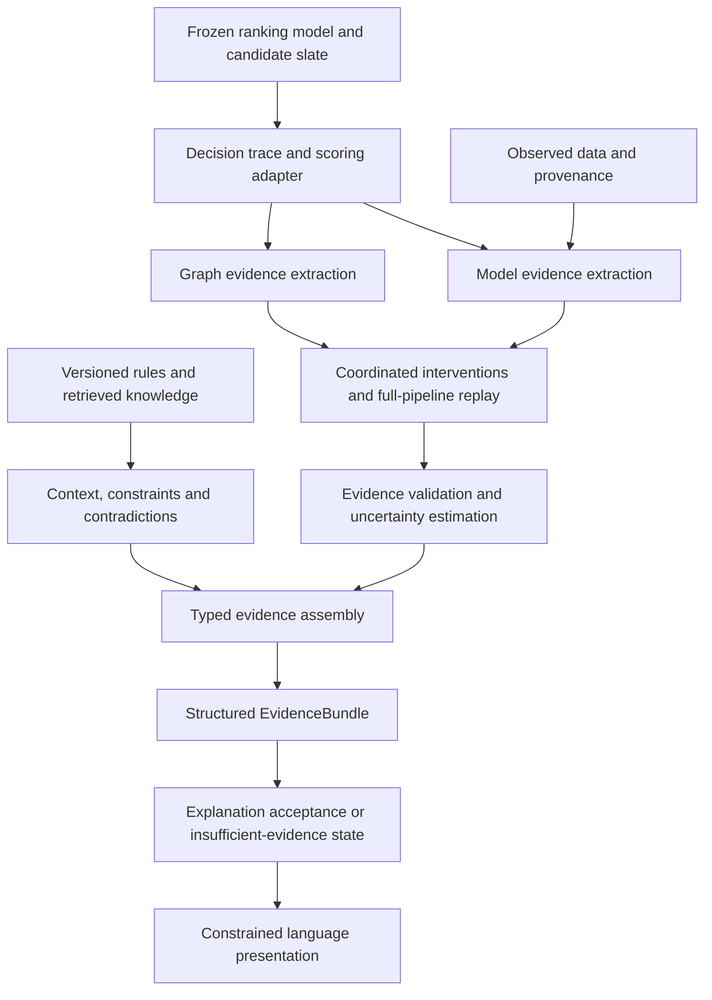

# Research plan: Faithful evidence for complex ranking systems

Historical research review. The current algorithm and implementation sequence
are in [ProposedExplainabilityIdea.md](ProposedExplainabilityIdea.md) and
[ExplainabilityImplementationPlan.md](ExplainabilityImplementationPlan.md).
The preliminary ledger described in this review was removed; its historical
audit results are not tests of the new numerical prototype.

## 1. Recommended contribution and the actual starting point

**The strongest realistic contribution is a method for validating and selecting evidence about a final ranking decision—not the Transformer–GNN architecture or the EvidenceBundle format by themselves.**

The proposed method should:

1. Explain a specific ranking contrast.
2. Apply coordinated interventions across every representation of the same underlying evidence.
3. Separate factors that influenced the model from external facts, constraints, and warnings.
4. Test explanatory claims by replaying the frozen ranking pipeline.
5. Withhold unsupported explanations while preserving uncertainty and missing-evidence information.
6. Permit an LLM to present only the resulting evidence.

A suitable working title is:

**“Replay-Validated Evidence for Faithful and Uncertainty-Aware Ranking Explanations”**

This is a **candidate methodological contribution requiring validation**. The current repository does not yet establish that it is novel or better than existing explainers.

Your selected scope is a medical case study without human participants. Consequently, the paper can establish computational faithfulness, evidence grounding, and model portability within that case study. It cannot establish cross-domain transfer, improved clinician understanding, or clinical benefit.

**What the repository already provides**

| Component | Verified current state | What remains for the explanation research |
|---|---|---|
| Data foundation | MIMIC-IV 3.1, MIMIC-IV-Note 2.2, and eICU 2.0 configuration; extraction, harmonization, temporal features, candidate catalogs, patient splits, provenance, and evaluation gates | An explanation benchmark manifest with its own patient partitions and intervention definitions |
| Transformer | Implemented event-sequence and structured-context ranker, including candidate-side priors and graph-derived tabular features | Attribution to meaningful input groups; input-gradient access where appropriate; replay validation |
| GNN | Implemented relational ranker, patient query subgraphs, candidate-conditioned pooling, relation controls, and fold-isolated preparation | Explanatory subgraph selection, path validation, and measurements of effects on the final ranking |
| Hybrid | Implemented within-slate normalization and paired late fusion; selected GNN variant `full`, weight `0.25` | A faithful explanation adapter that reproduces exactly this scoring computation |
| Ranking results | Aggregate report records NDCG@10 of approximately **0.4250 versus 0.4119**, across 65,062 MIMIC-test ranking groups | These results establish a useful experimental predictor, not explanation quality |
| Probability calibration | Separate affine-sigmoid calibration fitted from paired training OOF predictions | Explanation uncertainty, rank robustness, and calibrated explanation acceptance |
| Explanation computation (updated) | Initial margin/route core and bounded attribution runner; former ledger removed | Clinical source adapters, authenticated replay, reversal search and validation of explanatory claims |
| Track C EvidenceBundle | Deterministic knowledge support, safety alerts, candidate summaries, provenance, and coverage notes on synthetic integration paths | Connection to actual model behavior, quantitative coverage, contradiction handling, and integration with the stricter ledger |
| Conversational extraction | Separate profile schema, extraction, clarification, and synthetic-test scaffolding | Validated integration with actual ranking inputs; this is not necessary for the first explanation paper |
| Natural-language explanation | Boundary and intended behavior documented | Implemented constrained presentation and unsupported-claim evaluation |

The central implementation reference is the [fusion computation](../../pipeline/gnn_training/fusion.py). The explanation method remains proposed and has no active ledger contract or runtime producer. Its current specification is [ProposedExplainabilityIdea.md](ProposedExplainabilityIdea.md).

Several findings should directly shape the paper:

- **There are two different graphs.** The learned graph contains training associations and pre-decision relationships. The curated graph contains knowledge and safety relationships. A curated `TREATED_WITH` edge is not proof that the GNN used that relationship.
- **Track C annotates rankings; it does not currently change them.** An allergy warning therefore cannot be described as the reason a candidate ranked lower.
- **The same evidence can enter multiple representations.** An observation can affect sequence tokens, numeric summaries, query-graph structure, and graph-related side features. Editing only one representation answers a different question from removing the underlying observation.
- **Fusion depends on the whole candidate slate.** Interventions must recompute within-slate normalization.
- **`candidate_rank` is catalog metadata.** The explanation adapter must calculate the model’s displayed rank using the actual score ordering and tie-breaking policy.
- **The contract verifies supplied records, not their truth.** Arithmetic conservation, a replay Boolean, or a data-safety declaration does not independently verify faithfulness or privacy.
- **Coverage is currently coarse.** Appearing in one safety relation does not imply coverage of all relevant rule families. The experimental dose-adjustment extension also needs alignment with coverage and provenance handling.
- **Documentation contains mixed milestones.** Some architecture and testing passages still describe completed work as pending. The coverage configuration also spans index conditions; the reported fusion result should not be relabeled as sepsis-only.
- **eICU readiness is strategy-specific.** The inspected manifest reports no evaluable positive groups for `rxnorm_or_atc`, while `atc3_or_rxnorm` is evaluable. That does not establish external validity for the frozen hybrid’s current candidate policy.

The [attached XAI document](/nfs/home/lisic/zahmed/ResearchModule/Documentation/ExistingXAIInterpretabilityPlanResearch.md) already proposes much of the ledger architecture. The research step is to turn that design into a precisely defined, falsifiable method.

## 2. Literature review and the defensible research gap

The primary-source review below covers foundational methods and close work available through **7 September 2026**. It is a targeted novelty assessment, not proof that no overlapping publication exists.

| Research area | What prior work establishes | Consequence for this paper |
|---|---|---|
| Feature attribution | SHAP provides additive attribution for a specified value function; LIME fits local surrogates; Integrated Gradients attributes differentiable outputs relative to a baseline. [SHAP](https://proceedings.neurips.cc/paper/2017/hash/8a20a8621978632d76c43dfd28b67767-Abstract.html), [LIME](https://arxiv.org/abs/1602.04938), [IG](https://proceedings.mlr.press/v70/sundararajan17a.html). | Combining these methods is not novelty. The explanation target, intervention semantics, and validation must contribute something additional. |
| Ranking explanations | ShaRP addresses scores, ranks, selection, and pairwise preferences. RankingSHAP formulates listwise attribution. RankSHAP develops ranking-specific axioms and evaluates ranking reconstruction. [ShaRP](https://arxiv.org/abs/2401.16744), [RankingSHAP](https://arxiv.org/abs/2403.16085), [RankSHAP, ICLR 2025](https://proceedings.iclr.cc/paper_files/paper/2025/hash/5aee2e1e186ac504c964095f06a31723-Abstract-Conference.html). | “Explain why A ranks above B” is established. These are essential baselines, not optional related work. |
| Computational graphs and multiple representations | Shapley Flow addresses attribution over graph-structured dependencies. InterSHAP quantifies modality contributions and interactions. [Shapley Flow](https://proceedings.mlr.press/v130/wang21b.html), [InterSHAP, AAAI 2025](https://ojs.aaai.org/index.php/AAAI/article/view/35452). | Hierarchical attribution, contribution conservation, and cross-modal interaction analysis cannot be claimed as new individually. |
| GNN explanation | GNNExplainer selects explanatory subgraphs/features; PGExplainer learns explanation masks; SubgraphX evaluates subgraphs using Shapley-based reasoning. [GNNExplainer](https://proceedings.neurips.cc/paper/2019/hash/d80b7040b773199015de6d3b4293c8ff-Abstract.html), [PGExplainer](https://proceedings.neurips.cc/paper/2020/hash/e37b08dd3015330dcbb5d6663667b8b8-Abstract.html), [SubgraphX](https://proceedings.mlr.press/v139/yuan21c.html). | A highlighted path or subgraph is not enough. Its relevance to the final hybrid ranking must be tested. |
| Graph-explanation evaluation | GraphFramEx distinguishes explanation sufficiency and necessity and provides systematic evaluation. [GraphFramEx](https://proceedings.mlr.press/v198/amara22a.html). | Use both retention and removal tests. Neither visual plausibility nor a single deletion score establishes faithfulness. |
| Knowledge-graph recommendation | PGPR generates recommendations using graph paths; PEARLM constrains path generation to the graph. [PGPR](https://arxiv.org/abs/1906.05237), [PEARLM](https://arxiv.org/abs/2310.16452). | Graph-valid paths and explanations faithful to a particular predictor are different properties. |
| Reusable recommender explanation | Xu and colleagues already propose a reusable, model-agnostic explanation framework and evaluate faithfulness and system scrutability. [Xu et al., TOIS 2023](https://doi.org/10.1145/3605357). | “A wrapper around any recommender” is an interface objective, not a sufficient novelty claim. |
| Attribution followed by language | FIRE combines SHAP with structured prompting for recommendation explanations. Its inspected version is a preprint. [FIRE, 2025](https://arxiv.org/abs/2508.05225). | SHAP → structured prompt → LLM is already close prior art. |
| Evidence bundles followed by language | An educational recommendation paper explicitly separates deterministic ranking, structured evidence bundles, and citation-enforced generation. [Yun et al., August 2026](https://www.frontiersin.org/journals/artificial-intelligence/articles/10.3389/frai.2026.1827553/full). | The EvidenceBundle architecture and LLM-as-presentation principle are established design patterns. |
| Multi-source evidence and consistency | CIRR proposes multi-source retrieval and consistency constraints linking recommendation and explanations; KAPER combines graph-path evidence with LLM reranking and explanation. CIRR is a preprint. [CIRR](https://arxiv.org/abs/2512.18683), [KAPER](https://www.sciencedirect.com/science/article/abs/pii/S0950705126009627). | “Multi-source, grounded, consistent explanations” is too broad a novelty claim. Distinguish explaining a frozen predictor from training a new evidence-conditioned recommender. |
| Negative-evidence disclosure | Recent work explicitly addresses omission of risk-relevant information through disclosure planning. [Mitigating selective disclosure, 2026](https://link.springer.com/article/10.1007/s44443-026-00826-z). | Showing contradictions is valuable, but not independently novel. Measure omission as well as factual correctness. |
| Explanation uncertainty and selection | Existing methods quantify uncertainty around explanations and identify inaccurate amortized explanations. [Marx et al., 2023](https://proceedings.mlr.press/v206/marx23a.html), [GPEC, 2024](https://proceedings.mlr.press/v238/hill24a.html), [Selective Explanations, NeurIPS 2024](https://proceedings.neurips.cc/paper_files/paper/2024/hash/647af5f6b2538524f6c047c1d9170fd9-Abstract-Conference.html). | Uncertainty intervals or selective explanation alone are not novel. Define the error being estimated and evaluate acceptance against it. |
| Language grounding | ALCE evaluates generated citations. Faithfulness research distinguishes plausible language from evidence of model behavior. [ALCE](https://aclanthology.org/2023.emnlp-main.398/), [Lyu et al., 2024](https://direct.mit.edu/coli/article/50/2/657/119158/Towards-Faithful-Model-Explanation-in-NLP-A-Survey). | A valid citation establishes a source link, not necessarily entailment or model influence. |
| Medical recommendation and decision support | GAMENet and SafeDrug already combine learned recommendation with drug relations and safety objectives. Clinician research identifies context-specific explanation needs. [GAMENet](https://ojs.aaai.org/index.php/AAAI/article/view/3905), [SafeDrug](https://www.ijcai.org/proceedings/2021/514), [What Clinicians Want](https://proceedings.mlr.press/v106/tonekaboni19a.html). | Medication architecture and safety-aware ranking belong in the experimental background. Human usefulness requires separate evidence. |

**The strongest remaining gap is more specific:**

> How can an explanation preserve the semantics of evidence shared across a complex ranking pipeline, and determine which claims about the final ordering are sufficiently supported to present?

The proposed contribution is therefore a **replay-validated method for constructing rank explanations**, combining:

- interventions on underlying evidence with consistent recomputation of dependent representations;
- a common final-ranking target;
- explicit evidence roles and provenance;
- empirical tests that govern admission of claims;
- uncertainty-aware explanation acceptance.

The individual tools remain established methods. The research must demonstrate that this combination addresses a measurable failure that strong ranking and compositional explainers do not already resolve.

**Critical novelty test:** compare against a strong rank-aware baseline equipped with the same intervention operator. If it matches the proposed method, the evidence supports an intervention methodology or evaluation contribution—not a new attribution algorithm.

## 3. Proposed architecture, formal object, and mathematics

**Architecture**



The generic core uses **query/context, candidates, scores, evidence, rules, and provenance**. Medical terminology belongs in adapters.

“Model-agnostic” means the core can operate through a scoring-and-replay interface. It does not mean that inaccessible gradients, hidden graphs, or unavailable source records can be recovered. Unsupported capabilities must remain explicitly unavailable.

**Minimum interfaces**

| Interface | Responsibility |
|---|---|
| `RankerAdapter` | Score an ordered candidate slate, reproduce final ordering, expose model/version identifiers and optional component traces |
| `InterventionAdapter` | Define evidence groups, apply permitted edits, and rebuild dependent representations |
| `EvidenceProvider` | Return typed model, observation, graph, rule, or retrieved-source records |
| `ReplayValidator` | Compare original and intervened decisions and produce validation measurements |
| `ExplanationSelector` | Select evidence under a size budget and decide whether explanation requirements are met |
| `Verbalizer` | Render an accepted claim plan without changing its meaning |

**Evidence classification needs two axes**

A graph relationship can be both graph-based and computational evidence. An observed feature can be data-based evidence whose model influence is unknown. A single mutually exclusive category cannot represent this accurately.

| Source type | What it establishes | Permitted explanatory role |
|---|---|---|
| Model | Score, attribution, branch contribution, measured response to intervention | Computational influence |
| Data | Observed field, timestamp, missingness, training support, source provenance | Observation or population context; influence only when tested |
| Graph | A typed relationship or subgraph exists | Computational influence if used and validated; otherwise contextual support |
| Rule | A versioned condition matched and produced an action | Annotation, penalty, exclusion, or abstention—whichever actually occurred |
| Retrieved knowledge | A source supports, contradicts, or qualifies a statement | External support; computational influence only if it entered scoring |
| Uncertainty/coverage | Limits of prediction, evidence availability, approximation, or validation | Qualification of another claim or explanation abstention |

A true external fact may contradict the model’s preference. Preserve both records.

**EvidenceBundle v2**

Extend the existing design through a new version and explicit adapters; preserve v1 compatibility.

| Bundle component | Required information |
|---|---|
| Decision trace | Protected query reference, complete slate reference/hash, score semantics, actual ranks, tie policy, candidate pair, decision stage |
| Versioning | Model, preprocessing, graph, rule, terminology, calibration, intervention, and explainer versions |
| Evidence atoms | ID, source type, role, proposition, provenance references, dependencies, polarity, applicable candidate/comparator |
| Numerical evidence | Attribution or replay effect, units, estimand, reference distribution, interval method, residual |
| Validation | Intervention identity, original/replayed result, validity checks, support status |
| Context and conflicts | Supporting and contradicting knowledge, rule annotations, unresolved conflicts |
| Coverage | Separate input, mapping, graph, rule-family, retrieval, and explanation-acceptance coverage |
| Uncertainty | Predictive calibration, perturbation-based rank robustness, attribution variability, unavailable estimates |
| Presentation | Allowed claims, required qualifications, mandatory warnings, explanation state |

Per-candidate summaries should present:

- actual rank and score meaning;
- the relevant comparator;
- validated support and opposition;
- external supporting or contradicting evidence;
- applicable rule annotations;
- missing evidence and uncertainty;
- explanation availability.

**All patient-linked bundles remain protected artifacts, even when they contain only references.** Aggregate reports must not contain individual bundles.

### Mathematical target

Let \(q\) be the decision context, \(C\) the fixed candidate slate, and

\[
s_\theta(q,C)\in\mathbb R^{|C|}
\]

the frozen scorer. Its ordering is \(\pi_\theta(q,C)\), including the deployed tie policy.

For candidates \(a,b\), define the primary target:

\[
\Delta_{a,b}(q,C)=s_\theta(q,C)_a-s_\theta(q,C)_b.
\]

Use candidate-specific explanations as views over these contrasts:

- top candidate versus runner-up;
- each displayed candidate versus its nearest higher-ranked competitor;
- rank \(K\) versus rank \(K+1\);
- an explicitly requested candidate pair.

A margin explains a preference, while actual rank also depends on the surrounding slate. Therefore, retain both margin-based and ordering-based evaluation.

For the selected hybrid:

\[
s_i=0.75\,z_C(t)_i+0.25\,z_C(g)_i,
\]

so

\[
\Delta_{a,b}
=
0.75\,[z_C(t)_a-z_C(t)_b]
+
0.25\,[z_C(g)_a-z_C(g)_b].
\]

This is an exact branch accounting identity. **The 25% GNN weight is not “25% of the explanation.”** Actual contributions depend on branch outputs.

Every intervention recomputes all candidate scores and both normalizations. Zero-variance and invalid-score behavior must match the existing implementation.

### Coordinated intervention semantics

Let \(u\) denote underlying evidence and \(\Psi\) the frozen feature/graph construction:

\[
q=\Psi(u).
\]

For retained evidence groups \(S\) and reference \(b\), define:

\[
I_{S,b}(q)=\Psi\!\left(I^{\mathrm{source}}_{S,b}(u)\right).
\]

This expresses the central implementation requirement: editing an underlying observation updates all its dependent representations.

Keep two experiments distinct:

- **Input-evidence intervention:** modify an observation and recompute its sequence, numeric, and query-graph descendants.
- **Computational graph intervention:** mask a message or relation while keeping observations fixed.

The second tests a model mechanism; it does not represent removal of a clinical fact.

Reference replacements must preserve the declared time window, immutable context, candidate identities, typing, and missingness semantics. Use training-only reference construction. Where valid replacement is unavailable, mark the intervention unsupported.

No claim of causal treatment effect follows from either experiment.

### Attribution and accounting

Define a coalition value:

\[
v_{a,b}(S)=
\mathbb E_{b\sim P_{\mathrm{ref}}}
\left[\Delta_{a,b}(I_{S,b}(q),C)\right].
\]

Use existing grouped Shapley estimation:

\[
\phi_j=
\sum_{S\subseteq N\setminus\{j\}}
\frac{|S|!(|N|-|S|-1)!}{|N|!}
\left[v(S\cup\{j\})-v(S)\right].
\]

Record:

\[
\Delta_{a,b}
=
\phi_0+\sum_j\phi_j+\epsilon_{\mathrm{approx}},
\qquad
\phi_0=v(\varnothing).
\]

For the additive hybrid, Shapley linearity permits branch-resolved contributions when both branches use the **same groups, coalitions, and references**. Shared observations receive one source-level total with linked branch contributions.

Three safeguards are necessary:

1. Shapley attribution is an average marginal effect under its game; it is not generally equal to a single deletion effect.
2. Overlapping paths must not count the same underlying edge repeatedly.
3. Small conservation residuals are arithmetic checks, not proof of faithfulness. A deliberately assigned residual can always make an equation balance.

IG and graph explainers can provide efficient candidate evidence. Their outputs must still be checked against the final ranking target. The current frozen inference wrappers detach tensors; an attribution-specific forward path must preserve input gradients while matching the original scores and keeping parameters unchanged.

### Evidence selection and faithfulness validation

Let \(S\) be a proposed explanation’s computational evidence. Define normalized sufficiency error:

\[
\operatorname{Suf}(S)=
\mathbb E_b
\left[
\frac{
|\Delta(q,C)-\Delta(I_{S,b}(q),C)|
}{\sigma_\Delta+\varepsilon}
\right],
\]

where \(\sigma_\Delta\) is a fixed training-reference scale, avoiding unstable division by a near-zero individual margin.

For a supporting evidence group \(j\), also record the measured removal effect:

\[
d_j=
\Delta(q,C)-
\Delta(I_{N\setminus\{j\},b}(q),C).
\]

Negative \(d_j\) is possible and meaningful. Redundancy can also make an individually weak deletion effect compatible with a useful joint explanation.

The selection objective is:

\[
\min_S \operatorname{Cost}(S)
\quad\text{subject to}\quad
\widehat{\operatorname{Suf}}(S)\le\tau_{\mathrm{suf}},
\quad |S|\le B,
\quad \operatorname{Valid}(S)=1.
\]

Mandatory warnings and contradictions are additional disclosure requirements, not terms that can be traded against favorable evidence.

Implement bounded greedy selection with replay checks. If it fails within the budget, report **“no validated compact explanation found within the search budget,”** rather than claiming that no explanation exists.

Validate selected evidence with fresh reference draws and intervention masks that were not used to select it.

### Uncertainty and explanation acceptance

Represent uncertainty as a vector:

\[
U=
\left(
U_{\mathrm{prediction}},
U_{\mathrm{rank}},
U_{\mathrm{attribution}},
U_{\mathrm{coverage}},
U_{\mathrm{validation}}
\right).
\]

For example,

\[
\widehat P_{\mathrm{perturb}}(a\succ b)
=
\frac1M\sum_{m=1}^{M}
\mathbf1[\Delta(I_m(q),C)>0]
\]

is robustness under a specified perturbation distribution. It is not the probability that \(a\) is the clinically correct choice.

Use the existing calibration only for its stated target: **observed prescribing under the locked candidate and time-window policy**. Temperature or sigmoid calibration does not establish explanation reliability. [Guo et al., 2017](https://proceedings.mlr.press/v70/guo17a.html).

For explanation acceptance, define an audit failure \(\ell(E,q)\): an incorrect checkable claim, a violated disclosure requirement, or failure of the preregistered fidelity criterion. For acceptance rule \(A_\tau\),

\[
R(\tau)=
\frac{\mathbb E[A_\tau(E,q)\ell(E,q)]}
{\mathbb E[A_\tau(E,q)]},
\qquad
\operatorname{Coverage}(\tau)=\mathbb E[A_\tau(E,q)].
\]

Calibrate acceptance thresholds on a separate patient partition. Use a frozen finite threshold grid and simultaneous binomial upper bounds; choose the highest-coverage threshold satisfying the declared error target. This adapts established risk-control ideas rather than claiming a new calibration theorem. [Learn then Test](https://arxiv.org/abs/2110.01052).

Any statistical guarantee applies only to the specified audit, sampling unit, and distribution. It does not certify clinical correctness or arbitrary distribution shift.

### Rules, counterfactuals, and language

**Rules:** preserve today’s annotation behavior. Additive penalties and hard exclusions can be supported by the generic schema, but must be attributed only when an actual policy executed them. Test those generic states with synthetic fixtures; do not silently introduce a clinical reranker.

**Counterfactuals:** include a bounded secondary experiment:

\[
\min_{\delta\in\mathcal A}c(\delta)
\quad\text{subject to}\quad
s_b(I_\delta(q),C)>s_a(I_\delta(q),C).
\]

Here \(\mathcal A\) contains structurally permitted edits. Replay every result. Label it a model-rank counterfactual, without suggesting that the edit is achievable or therapeutically beneficial.

**Language:** the authoritative output is a typed claim plan. The LLM may organize and verbalize it, but cannot select new reasons.

For the primary implementation, use allowed claim types and validated sentence patterns, with semantic values inserted by the renderer. Experimental free paraphrasing can be evaluated separately.

Check candidate identity, comparator, direction, numerical values, source role, citations, uncertainty qualifications, and mandatory warnings. Failed validation produces a deterministic rendering or an insufficient-evidence response.

An evidence ID alone is insufficient: the linked evidence must support the proposition. Automated entailment or a second LLM may assist evaluation, but cannot serve as an unquestioned semantic oracle.

## 4. Research questions and experimental framework

### RQ1 — Does coordinated evidence intervention improve ranking faithfulness?

**Research gap →** Explanations can probe one branch or representation while another still contains the supposedly removed information. Pointwise scores also omit slate-level effects.

**Research question →** Do source-level interventions with complete dependent recomputation produce more faithful final-ranking explanations than independent component explanations?

**Hypothesis →** At matched evidence size and computation, coordinated explanations better preserve the ranking when retained and better identify ranking changes when evidence is removed.

**Method →** Common rank-margin target, provenance-linked evidence groups, coordinated replay, and exact accounting for deployed fusion.

**Mathematical formulation →** Compare \(v_{a,b}(S)\) using coordinated \(I_{S,b}\) with representation-local interventions; evaluate \(\operatorname{Suf}(S)\), removal effects, and ordering agreement.

**Experiment →** Explain the same frozen Transformer, GNN, and hybrid decisions using pointwise, rank-aware, independent multi-method, and coordinated approaches.

**Evaluation metrics →** Sufficiency error, pairwise ordering agreement, Kendall’s \(\tau_b\), top-\(K\) preservation, signed removal effects, and error under held-out interventions.

**Expected evidence →** Paired improvements concentrated in shared-evidence, branch-disagreement, and slate-normalization cases. If a rank-aware baseline with the same coordinated adapter matches the method, attribute the gain to intervention semantics rather than a new attribution rule.

### RQ2 — Can typed evidence prevent false reasoning and concealed contradictions?

**Research gap →** A source may support a candidate without explaining the score. Fluent bundles can also omit opposing evidence.

**Research question →** Does separating computational influence, external support, rule actions, and coverage reduce false explanatory claims compared with concatenating evidence sources?

**Hypothesis →** Role-aware bundles reduce statements that incorrectly attribute model behavior to external knowledge and preserve more relevant contradictions.

**Method →** Typed evidence roles, dependency links, explicit actual-action traces, required contradiction disclosure, and claim validation.

**Mathematical formulation →**

\[
\operatorname{Admit}(c,E)=
\operatorname{SourceSupports}(c,E)
\land
\operatorname{RoleCompatible}(c,E)
\land
\operatorname{ReplaySupports}(c,E),
\]

where replay support is required for computational claims, not for every contextual statement.

**Experiment →** Use genuine model/knowledge disagreements and controlled perturbations of evidence IDs, polarity, candidate mappings, rule actions, and missingness.

**Evaluation metrics →** Source-role error rate, contradiction precision/recall, rule-action trace accuracy, critical-omission rate, and unsupported-claim rate.

**Expected evidence →** The system retains a model preference and a contradictory warning without inventing a connection between them. Removing contextual knowledge should affect contextual completeness, while leaving the frozen ranking unchanged.

### RQ3 — Can uncertainty improve the reliability of explanations that are actually issued?

**Research gap →** Predictive confidence, attribution variability, missing evidence, and explanation failure are different quantities.

**Research question →** Can explicit validation uncertainty and coverage yield lower explanation error at useful acceptance coverage?

**Hypothesis →** A calibrated acceptance policy produces fewer failed explanations than score-confidence thresholds or unconditional explanation, at matched coverage.

**Method →** Separate uncertainty fields, repeated explanation estimation, held-out replay audits, and calibrated acceptance.

**Mathematical formulation →** Optimize \(\operatorname{Coverage}(\tau)\) subject to an upper bound on \(R(\tau)\).

**Experiment →** Evaluate complete-input, missing-data, weak-graph-coverage, near-tie, and branch-disagreement strata. Introduce controlled missingness separately from naturally missing data.

**Evaluation metrics →** Risk–coverage curves, area under those curves, error at fixed coverage, coverage at the target error rate, attribution sign stability, and interval coverage on small exactly enumerable cases.

**Expected evidence →** Error declines without achieving apparent reliability merely by rejecting almost every case. Calibration failures under shift remain visible.

### RQ4 — Does evidence-first presentation reduce unsupported language?

**Research gap →** Structured evidence generation already exists, but supplied evidence can still be distorted, selectively disclosed, or misrepresented as model reasoning.

**Research question →** What benefit comes from validated evidence, structured claims, and final verification separately?

**Hypothesis →** Evidence-first generation with claim verification reduces unsupported statements and required-warning omissions compared with direct LLM explanation and evidence prompting alone.

**Method →** Frozen claim plan, explicit evidence references, controlled rendering, and independent output checks.

**Mathematical formulation →**

\[
\operatorname{UCR}
=
\frac{\#\text{claims unsupported by the applicable evidence}}
{\#\text{checkable claims}},
\]

reported alongside unverifiable-claim rate and required-claim recall.

**Experiment →** Hold the LLM, cases, available inputs, and output budget constant across direct explanation, unstructured evidence, typed evidence, and typed evidence plus verification.

**Evaluation metrics →** Unsupported claims, wrong entities/numbers/directions, source-role misuse, omitted warnings, verified-claim coverage, and fallback frequency.

**Expected evidence →** Improvement remains when compared at matched information content and output length. Constrained rendering is a correctness reference; it cannot establish improved human understanding.

### Common experimental design

**Prediction task and splits**

- Freeze the existing predictor, candidate policy, preprocessing, calibration, and graph artifacts.
- Preserve patient separation and the existing 24-hour feature cutoff with the subsequent `(24h, 48h]` observed-prescription label.
- Keep `label_prescribed`, future events, and outcomes outside explanation inputs and prompts.
- Record any admission-level diagnosis whose decision-time availability is uncertain. Faithfully explaining such a dependency does not resolve its prospective leakage implications.
- Create a separate explanation-development, calibration, and final-evaluation partition by patient.
- Use the previously consumed MIMIC test only as a **retrospective fixed-model explanation benchmark**, with explicit disclosure. Do not describe it as a new untouched predictor test or reopen the one-shot scoring gate.
- Construct reference replacements from training data only.
- Keep the first study within the existing medical representation. eICU transfer and conversational extraction remain outside the primary experiment.

**Bounded starting configuration**

Use a fixed seed of `20260617`, targeting 200 development, 500 calibration, and 500 final-evaluation patients, with one deterministically selected ranking group per patient for primary inference. If fewer patients qualify, use all eligible patients with the same proportions and report reduced precision.

Use a primary budget of ten computational evidence groups and a ceiling of 512 full-slate scoring queries per explanation. Report additional size/cost curves. All extraction, selection, and replay calls count toward the method’s budget; independent final audits receive a separate equal budget across methods.

These are workload defaults, not power claims. Freeze any feasibility-driven adjustment on development data before calibration and evaluation.

**Baselines**

| Baseline family | Required comparison |
|---|---|
| Conventional attribution | Grouped SHAP, LIME, and IG where gradients are available |
| Ranking-aware attribution | ShaRP, RankingSHAP, and RankSHAP, with adaptations explicitly documented |
| Attention | Available Transformer/GNN attention or pooling weights, treated as diagnostic baselines |
| Graph explanation | Graph paths, GNNExplainer, and a budget-matched graph-mask method |
| Compositional explanation | Independent branch attribution plus exact fusion accounting; Shapley Flow-style dependency attribution where applicable |
| Existing system | Track C knowledge/safety bundle without model attribution |
| Language | Direct LLM, attribution-to-LLM in the style of FIRE, unstructured evidence-to-LLM, typed evidence without verification, and deterministic templates |

Give the strongest computational baselines the same evidence access and coordinated intervention adapter. Otherwise, a gain might result solely from withholding information from competitors.

**Ablations**

Remove each evidence source independently:

- model attribution;
- observed-data provenance;
- learned-graph evidence;
- curated knowledge;
- rule traces;
- uncertainty;
- coverage information.

Also remove each proposed mechanism independently:

- coordinated recomputation;
- rank-aware target;
- source-role separation;
- duplicate-evidence handling;
- contradiction disclosure;
- replay validation;
- acceptance calibration;
- output verification.

Keep the ranker fixed for explanation ablations. Removing a predictor branch is a separate model experiment.

**Evaluation scenarios**

| Property | Test |
|---|---|
| Faithfulness | Retain/remove evidence using fresh reference draws; compare with random evidence at matched size |
| Completeness | Separate arithmetic conservation, preservation of model behavior, and disclosure of known warnings |
| Consistency | Reverse candidate/comparator; check signed contributions and statement polarity; detect conflicting claims |
| Rank preservation | Retain selected evidence and measure pairwise order, full-list agreement, and top-\(K\) membership |
| Rank sensitivity | Test whether explanations change appropriately after valid rank-changing interventions |
| Slate effects | Permute storage order; add/remove a candidate in a separately declared slate experiment and recompute normalization |
| Stability | Repeat explanation sampling; test representation-equivalent inputs and small valid perturbations, conditional on predictor stability |
| Graph faithfulness | Validate edge existence and test subgraph necessity/sufficiency; distinguish graph masking from input removal |
| Uncertainty | Evaluate approximation intervals and rank robustness separately from observed-prescription calibration |
| Coverage | Report unavailable fields, mappings, rule families, graph support, and accepted explanations with explicit denominators |
| Language | Introduce wrong IDs, polarity, values, citations, and omitted warnings; measure verifier errors too |
| Sanity | Randomized model parameters, irrelevant evidence, duplicate representations, zero-variance scores, ties, singleton slates, and empty explanations |

Use exact small synthetic fixtures to test known computational dependencies. These are method tests within the medical study, not evidence of real cross-domain transfer.

Report paired patient-level effects with 95% bootstrap intervals, predefined primary metrics, and multiplicity correction across confirmatory comparisons. Include negative results, runtime, memory, model-call counts, and rejection rates.

**Acceptance criteria**

The research supports a stronger-method claim only if:

- it improves held-out behavioral fidelity against strong ranking-aware baselines at matched size and cost;
- its acceptance policy improves the error–coverage tradeoff;
- its evidence roles reduce false model-reason claims and critical omissions;
- language verification reduces unsupported claims without hiding information through excessive rejection.

Use a proposed target of at most **5% audit failure at at least 50% explanation acceptance**, with the uncertainty bound reported. Missing that target is a result to disclose, not a reason to redefine success after evaluation.

Without participants, report compactness, readability statistics, and mechanically answerable information as descriptive measures only. Human interpretability, appropriate reliance, and clinician error detection remain future experiments.

## 5. Implementation sequence and paper framing

**Stage 1 — Reproduce and capture the decision**

Build the generic ranking adapter and immutable full-slate trace. Verify exact scoring, normalization, masks, catalog metadata, and tie handling.

Create explicit bridges between ranking tokens and Track C vocabulary. Unmapped or ambiguous candidates remain uncovered. Preserve model and source provenance through the adapter rather than silently dropping fields.

Deliverable: replay of existing decisions with no explanation-induced change in scores or ranks.

**Stage 2 — Specify the explanation contract**

After the scoring snapshot and intervention semantics are agreed, add a new
contract under `pipeline/explainability/`. There is no previous ledger schema
to preserve or adapt.

Separate explanation acceptance from the predictor’s decision status. A ranked candidate may have insufficient evidence for a reliable explanation.

Preserve rule approval/version information, normalize the experimental dose-adjustment handling, and make coverage specific to rule families. Do not introduce new clinical rules or alter ranking policy.

Deliverable: synthetic contract and integration tests covering source roles, contradictions, mappings, missing evidence, and protected references.

**Stage 3 — Implement coordinated explanations**

Add provenance-linked evidence groups, bounded interventions, exact hybrid accounting, grouped attribution, graph evidence, and replay-based selection.

Start with model-agnostic scoring queries. Add IG only through a forward path proven equivalent to the frozen scorer.

Deliverable: candidate comparisons with measured support/opposition, compactness limits, and explicit residuals.

**Stage 4 — Add uncertainty and run the computational study**

Separate approximation variability, perturbation robustness, predictive calibration, and coverage. Implement the acceptance policy and freeze the experiment manifest.

Run the bounded benchmark on Calculco through subsequently authorized OAR jobs. Keep individual artifacts under protected storage and publish only aggregates.

Deliverable: baseline comparisons, ablations, risk–coverage curves, failure analysis, and reproducible manifests.

**Stage 5 — Add language and write the paper**

Implement claim-plan rendering and controlled LLM presentation. Evaluate unsupported claims and omissions using the same cases and frozen computational evidence.

Synchronize the research objective, architecture boundary, milestone status, operating commands, testing documentation, and changelog. Preserve the attached document as prior planning context.

**Proposed manuscript structure**

1. **Title and abstract:** generic ranking-explanation problem, proposed mechanism, medical evaluation, and precise claim limits.
2. **Introduction:** failures caused by inconsistent evidence interventions and confusion between model influence and external justification.
3. **Related work:** ranking attribution, compositional/GNN explanation, evidence-grounded language, uncertainty, and selective explanation.
4. **Method and mathematical formulation:** interfaces, intervention semantics, rank target, typed evidence, replay validation, acceptance, and presentation.
5. **Evaluation:** fixed medical predictors, strong baselines, controlled tests, ablations, calibration, language errors, and limitations.
6. **Conclusion:** only the properties demonstrated by the experiments.
7. **References:** verified primary sources, with preprints clearly identified.

**Working abstract, before results**

> Complex ranking systems combine heterogeneous representations and contextual evidence, making it difficult to distinguish factors that influence an ordering from information that merely supports its interpretation. We propose a replay-validated explanation framework that operates on a frozen ranker and a versioned candidate slate. The framework coordinates interventions across dependent representations, evaluates candidate-relative evidence, and separates computational contributions from external knowledge, constraints, and coverage limitations. A structured evidence object governs both explanation acceptance and natural-language presentation. We evaluate the method using medication-ranking models, comparing behavioral fidelity, stability, evidence disclosure, and unsupported claims against attribution, graph, ranking-aware, and language baselines. The study tests computational reliability; cross-domain transfer and human interpretability remain outside its validated scope.

**Complete transformation**

```text
Current Medical Recommendation System
    ↓
Useful rankings, separate knowledge/safety bundles,
and an explanation contract without computed faithfulness
    ↓
Generic Explainability Problem
    ↓
Which heterogeneous evidence actually explains a final ordering,
and which claims are sufficiently supported to present?
    ↓
Research Gap
    ↓
Inconsistent interventions across shared representations;
confusion between computational influence and external justification
    ↓
Research Questions and Hypotheses
    ↓
Coordinated rank explanations improve behavioral fidelity;
typed evidence and calibrated acceptance reduce explanation errors
    ↓
Proposed Multi-Source Explainability Framework
    ↓
Source provenance → coordinated interventions → final-rank replay
→ typed evidence → uncertainty → accepted claim plan
    ↓
Mathematical Formulation
    ↓
Rank margins, coalition values, sufficiency constraints,
explicit evidence roles, and explanation risk–coverage
    ↓
Experiments
    ↓
Strong rank-aware baselines, matched budgets, ablations,
independent replay audits, and grounded-language comparisons
    ↓
Evidence of Faithfulness and Reliability
    ↓
Measured improvements with uncertainty and failure analysis
    ↓
Domain-Independent Research Contribution
    ↓
Generic method and interfaces; empirical transfer remains unproven
    ↓
Medical Case Study for Validation
```

The legitimate claim today is that the repository provides a strong experimental foundation. The claim to pursue is that **coordinated evidence interventions and replay-governed claim selection improve explanations of frozen ranking systems**. Neither a new schema nor better prose alone would establish that contribution.

This review changed no files and submitted no HPC jobs. Verification completed: **38 contract/configuration tests, 44 Track C tests, and focused Ruff checks passed**. No patient-level clinical records were inspected or included.
