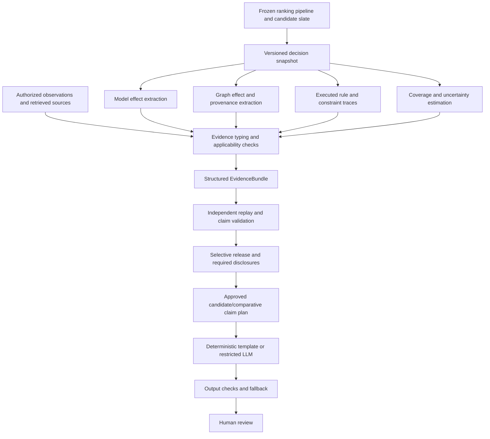

# Faithful and Selective Explanations for Complex Ranking Systems

**Research design and literature review — 2026-09-07.** Proposed methodology;
no explanation-quality results are claimed. The medical recommender is the
first experimental case study. This document is a historical research review;
the current algorithm and implementation status are in
[ProposedExplainabilityIdea.md](ProposedExplainabilityIdea.md) and
[ExplainabilityImplementationPlan.md](ExplainabilityImplementationPlan.md).

The strongest realistic contribution is **a method for constructing and
selectively releasing structured explanations of a frozen ranking pipeline**.
It must replay the decision being explained, distinguish computational
influence from external support, and measure the risk of releasing an
unreliable explanation. A multi-source JSON schema or a Transformer–GNN
architecture alone would remain an engineering contribution.

The recommended mechanism has three connected parts:

1. **Common ranking interventions:** one versioned intervention changes all
   representations of the same underlying information and recomputes the
   complete ranking pipeline, including slate-dependent normalization.
2. **Evidence typing and claim validation:** model effects, observations,
   graph relations, constraints, and external support have different permitted
   claims. Agreement or repetition does not make them independent evidence.
3. **Selective explanation:** release a detailed explanation only when its
   replay, coverage, and reliability checks pass; otherwise retain the score
   and limitations and report which explanatory claims cannot be supported.

All three are research proposals. Their ingredients have substantial prior
art. The defensible claim must concern their operational combination and
measured benefit against strong alternatives, especially rank-aware explainers
given the same inputs and query budget.

## 1. Proposed title and abstract

**Preferred working title:** *Faithful and Selective Explanations for Complex
Ranking Systems through Structured Multi-Source Evidence*.

**More conservative title if reliability calibration proves infeasible:**
*Auditing Multi-Source Explanations of Ranking Systems with Structured Evidence
and Consistent Interventions*.

**Proposal abstract, without invented results:**

Complex ranking systems combine contextual representations, relational
information, and decision constraints, making it difficult to distinguish
evidence that influenced a ranking from evidence that merely supports its
interpretation. We propose a domain-independent explanation framework that
represents a ranking decision as a versioned collection of computational,
observational, relational, constraint, and uncertainty evidence. The method
uses common interventions across representations to explain candidate
contrasts in their full ranking context. An evidence validation stage checks
model replay, provenance, contradictions, and required disclosures before a
selection policy determines which explanations can be released. Natural
language generation is restricted to presenting approved claims. We formulate
explanation reliability as a measurable selective-risk problem and specify
conditions under which calibration can bound a defined audit-failure rate.
Evaluation will compare rank-aware attribution, graph explanation, and
grounded language baselines using controlled synthetic tasks, a nonmedical
recommendation dataset, and a retrospective medication-ranking case study.
The study tests whether the framework improves intervention faithfulness and
disclosure reliability at comparable explanation coverage and computational
cost. Clinical effectiveness and causal treatment benefit are outside the
claims of this work.

The final submission must replace proposal tense with measured results and
confidence intervals only after the experiments have been completed.

## 2. Introduction: from the current project to a generic problem

### 2.1 Scientific framing

The professor's distinction is useful, although domain-specific methodological
research can also be publishable. General terminology alone does not create
novelty. The paper needs a falsifiable problem, a concrete method, and evidence
that the method solves a problem existing alternatives do not solve as well.

The central question is:

> How can we design an explainability framework for complex ranking and
> recommendation systems that produces faithful, structured, evidence-grounded,
> and uncertainty-aware explanations independently of the application domain?

Operationally: **given a frozen ranker, a candidate slate, heterogeneous
evidence, and limited model access, which explanatory claims about the ranking
can be justified, tested, and reliably communicated?**

This question separates five objects that an engineering presentation can
blur: the predictor, its decision, the explainer, the evidence supporting the
explanation, and the final presentation. The predictor need not improve for
the explanation method to contribute scientifically.

### 2.2 Audit scope and evidence standard

The audit inspected active ranking/model code, path and data contracts, graph
construction, scoring/calibration,
and relevant research and operational documentation. It checked the three
paired-OOF aggregate selection, gate, and calibration reports through
`pipeline/config.py`. No raw clinical tables, notes, or patient-level score
files were inspected. No training, extraction, or OAR job was launched.

Repository anchor: commit `241ec71`, with pre-existing local documentation
changes. Statements below describe the inspected working tree. In particular,
current P1 source capabilities must not be assumed to describe every older
P0 checkpoint: experiment claims require the recorded checkpoint/configuration
hashes, not simply today's class definitions.

The supplied [existing XAI plan](ExistingXAIInterpretabilityPlanResearch.md)
was treated as background to review, not as an instruction to execute its
suggested experiments. It already proposes a rank-evidence ledger and
acknowledges prior art. This proposal builds on that design; it does not claim
that the ledger concept was discovered anew here.

### 2.3 What exists, and what does not

| Surface | Inspected implementation or record | Meaning for the paper |
| --- | --- | --- |
| Data foundation | [cohort.py](../pipeline/cohort.py), [harmonize.py](../pipeline/harmonize.py), [features.py](../pipeline/features.py), [build_training_table.py](../pipeline/build_training_table.py), [training_contract.py](../pipeline/training_contract.py) | Reusable research infrastructure: temporal features, patient splits, train-fit catalogs, provenance, observational labels. These are experimental prerequisites. |
| Datasets | MIMIC-IV v3.1, MIMIC-IV-Note v2.2, eICU-CRD v2.0 are documented locally | Structured MIMIC is the main ranking case study. Available notes do not imply an implemented note encoder. eICU is coverage-oriented under the current package. |
| Transformer | [neural_training/model.py](../pipeline/neural_training/model.py) | Event tokens plus time/value/missingness projections, positions and a summary token; static context; candidate and condition embeddings; candidate-side features; MLP plus condition-gated dot-product scoring. It is not currently a clinical conversation LLM or a general note-reading model. |
| Transformer side information | Candidate catalog rank, training priors and graph-derived tabular summaries are used in the active branch | A context attribution must include these dependencies. The Transformer and GNN do not necessarily receive independent evidence. A faithful explanation may reveal reliance on historical popularity. |
| Relational ranker | [gnn_training/model.py](../pipeline/gnn_training/model.py), [graph_encode.py](../pipeline/gnn_training/graph_encode.py), [crossfit.py](../pipeline/gnn_training/crossfit.py) | R-GCN-style typed message passing, relation gates, candidate-conditioned observed-context pooling, candidate representations and rank features; fold-excluded fitting. P1 adds explicit stay/numeric/time representations. Gates and pooling weights are inspectable quantities, not proven attributions. |
| Candidate generation | Training-only condition–medication catalog; [Candidatelist.md](Candidatelist.md) explains the intended division of labor | Current GNN scores catalog candidates. It does not autonomously discover a clinically complete candidate universe. Explain catalog absence separately from a low rank. |
| Fusion | [fusion.py](../pipeline/gnn_training/fusion.py), [paired_late.py](../pipeline/gnn_training/paired_late.py), [paired_oof.py](../pipeline/gnn_training/paired_oof.py) | Current promoted ranking uses within-slate standardized branch logits and a frozen blend. Residual fusion code also exists; it is not the promoted paired result. |
| Score outputs | Per-candidate score tables and aggregate ranking metrics; [paired_calibration.py](../pipeline/gnn_training/paired_calibration.py) exposes `rank_score` separately from `probability_observed_prescription` | Scores, labels, and ranks are not explanation objects. Older `score` fields have stage-specific semantics; adapters must read the actual scorer/protocol rather than assume all scores are logits or probabilities. |
| Graph evidence | [graph_suitability.py](../pipeline/graph_suitability.py), [patient_subgraphs.py](../pipeline/patient_subgraphs.py) | Train-fit empirical concept edges and query subgraphs exist. No intervention-validated explanation subgraph/path extractor is wired into the ranking workflow. |
| Explanation representation | [ProposedExplainabilityIdea.md](ProposedExplainabilityIdea.md) | The proposed decision target, route decomposition, interventions, replay checks, and rank-reversal search are documented. No explanation schema or producer exists. |
| Explanation computation (updated) | Initial numerical margin/route core and bounded grouped attribution with synthetic tests | Frozen-model integration, clinical/graph interventions, faithfulness replay, reversal search and explanation evaluation remain planned. |
| Safety | Time-valid allergy/constraint features and certificate types exist | This is not a deployed, curated allergy/DDI/dose/contraindication rule engine. The contract checks supplied certificate metadata; it does not itself execute or validate clinical rules. |
| External evidence | Versioned external-knowledge record types and conceptual plans | Retrieval, source applicability checking and claim support validation are not implemented runtime capabilities. |
| Uncertainty | Temperature and paired-OOF probability calibration code | Calibration of observed-prescription probabilities exists. Explanation intervals, explanation-failure calibration, calibrated abstention and rank stability estimators remain to be designed. |
| Candidate summaries and language | Planned architecture; no active `CandidateSummary`/`EvidenceBundle` producer or grounded verbalizer found | A candidate summary should become a deterministic view of validated evidence. Conversational extraction, language generation and clinician evaluation remain planned. |

The previous preliminary evidence-ledger prototype has been removed. A future
contract should be designed only after the full-slate snapshot, intervention
semantics, and proposed route decomposition have been reviewed.

References in a ledger remain potentially sensitive when linked to a case.
Reference-only serialization and a data-safety declaration do not prove
anonymity, validate reference contents, or authorize external LLM processing.

### 2.4 What the ranking experiments establish

The aggregate paired gate records GNN `full`, alpha `0.25`, and:

| Recorded MIMIC-test gate metric | Frozen Transformer | Paired fusion |
| --- | ---: | ---: |
| NDCG@10 | 0.411888 | 0.425001 |
| MRR@10 | 0.515714 | 0.527926 |
| Hit@10 | 0.876571 | 0.888176 |

The NDCG@10 difference is `+0.013113`. The report contains 65,062 ranking
groups, including 60,148 positive-label groups; these are not independent
patient counts. Ranking metrics use the pipeline's evaluability convention.
The ranking promotion gate passed. This is useful experimental infrastructure,
not evidence that the explanations are faithful or the medications optimal.

The calibration report confirms a completed affine-sigmoid mapping for both
branches, fitted/selected using paired train OOF evidence. The selected hybrid
mapping reports cross-fitted Brier `0.068825` and 10-bin ECE `0.001424`.
These are candidate-row, train-OOF calibration results; they do not establish
top-ranked, subgroup, external, clinical-safety, or explanation calibration.

The original test-gate Brier/ECE figures concern uncalibrated score handling,
not that later mapping. The Transformer test split had already been used in
the broader program. Reusing it for this paper must be disclosed as
retrospective analysis, not described as a wholly untouched final test.
See [the result review](HybridModelResultReview.md) and
[paired protocol](PairedOOFLateFusionProtocol.md).

### 2.5 Data and semantic limitations that explanations must disclose

The documented prediction cutoff is 24 hours after ICU/unit admission; the
label window is `(24h, 48h]`. Patient-level splits and train-fit graph/catalog
statistics are central controls. Unobserved prescribing is not a verified
negative clinical decision, and co-prescribing is not evidence of compatibility.

The empirical graph contains:

- `condition_medication_train_positive`;
- `condition_lab_predecision`, `condition_vital_predecision`, and
  `condition_intervention_predecision`;
- `medication_medication_train_coprescribed`;
- stay/query/context relations in the newer GNN representation, plus reverse
  edges and self-loops.

These names should appear in provenance. A co-prescribing edge cannot be
verbalized as “these medications are safe together.” A condition–medication
training edge cannot be verbalized as “a guideline recommends this treatment.”
Ontology, interaction, contraindication and guideline graphs would be
separate, curated, versioned additions with distinct semantics.

One unresolved temporal prerequisite deserves explicit attention:
`stay_conditions_cte` in `build_training_table.py` assigns ranking conditions
from harmonized condition records without a decision-time filter in that
function. Untimed diagnoses may therefore define a retrospective stratum
without being known at 24 hours. An explanation of a retrospective
condition-indexed ranker is possible, but claiming a real-time clinical
decision requires independently verifying index-condition availability. Do not
silently change this cohort/label contract to solve the research-framing task.

MIMIC-to-eICU transfer tests source shift within medicine, not domain
independence. Current eICU mapping/evaluability gates prevent unsupported
supervised external-ranking claims. Notes, post-decision outcomes, future
reviews and target-item interactions must not enter explanation inputs merely
because they make an explanation sound credible.

### 2.6 The generic limitation

A multi-stage system can produce an explanation that is numerically tidy,
factually true, and still misrepresents its decision. For example:

- the narrative attributes a ranking to a graph path never used by the model;
- separate branch attributions use different baselines or duplicated features;
- a rule is mentioned as a reason although it was evaluated only after scoring;
- a candidate's score is explained without explaining its competitors;
- a small reconstruction residual conceals arbitrary feature allocation;
- every displayed statement is supported but decisive counterevidence is omitted;
- calibrated prediction probabilities are mislabeled as explanation confidence.

The generic research problem is to **align explanation claims with the actual
decision computation and available evidence, then control when those claims
are communicated**.

## 3. Related work and novelty assessment

### 3.1 Review method and limits

This is a targeted, primary-source literature review through 2026-09-07,
covering attribution, ranking, graphs, model composition, grounded generation,
selective reliability and decision support. Searches included “model-agnostic
faithful recommendation,” “RankingSHAP / RankSHAP / ShaRP,” “graph path
evidence,” “SHAP language explanation,” “selective explanations,” “calibrated
explanations,” and “risk control recommendation.” Publisher/proceedings pages,
author papers and arXiv manuscripts were checked; selected references and
nearby work were followed to challenge the proposed novelty.

This is not a registered systematic review or proof of absence. FIRE and
Selective Explanations are cited as preprints according to the versions
inspected. KAPER's publisher abstract/preview supports its stated architecture;
this review does not claim to have audited inaccessible supplementary results.
Before submission, update the search and reproduce the closest baselines.

### 3.2 Literature map

| Work and status | Established mechanism or finding | Consequence for this proposal |
| --- | --- | --- |
| [LIME — Ribeiro et al., 2016](https://arxiv.org/abs/1602.04938) | Local surrogate explanations through perturbed model queries | A conventional baseline. Local fit depends on the neighborhood and does not automatically describe an entire ranking pipeline. |
| [SHAP — Lundberg and Lee, NeurIPS 2017](https://papers.nips.cc/paper/2017/hash/8a20a8621978632d76c43dfd28b67767-Abstract.html) | Additive feature attribution under a specified value function | Attribution, additive accounting and Shapley allocation are existing methods; changing their wrapper is not a new attribution theorem. |
| [Integrated Gradients — Sundararajan et al., ICML 2017](https://proceedings.mlr.press/v70/sundararajan17a.html) | Gradient integration from a reference with sensitivity and implementation-invariance motivation | Useful differentiable adapter. Baseline/path choice and grouping remain substantive assumptions. |
| [Attention is not Explanation — Jain and Wallace, 2019](https://aclanthology.org/N19-1357/) and [Wiegreffe and Pinter, 2019](https://aclanthology.org/D19-1002/) | Evidence against treating attention as automatically explanatory, with counterarguments and diagnostic tests | Include attention as an empirically tested baseline. Neither blanket faithfulness nor universal uselessness follows for this hybrid. |
| [GNNExplainer — Ying et al., NeurIPS 2019](https://arxiv.org/abs/1903.03894), [PGExplainer — Luo et al., NeurIPS 2020](https://proceedings.neurips.cc/paper/2020/hash/e37b08dd3015330dcbb5d6663667b8b8-Abstract.html) | Prediction-related subgraphs/feature masks and an amortized graph explainer | Use established graph explainers as proposals; validate their effect on the same final ranking target. |
| [GraphFramEx — Amara et al., LoG 2022](https://proceedings.mlr.press/v198/amara22a.html) | Systematic graph-explainer evaluation using necessary/sufficient behavior | Graph faithfulness evaluation is prior art. This project extends the tested decision boundary to the full ranking pipeline. |
| [G-DeepSHAP — Chen et al., Nature Communications 2022](https://www.nature.com/articles/s41467-022-31384-3) | Propagation of attribution through a series of models | Explaining composite models and conserving contributions across stages are not new in themselves. |
| [Xu et al., ACM TOIS, online 2023](https://doi.org/10.1145/3605357) | A reusable model-agnostic explanation framework, distillation, and faithfulness/scrutability evaluation | Directly defeats a broad “first model-agnostic explainable recommender” claim. Compare against its teacher–explainer strategy where compatible. |
| [RankingSHAP — Heuss et al., SIGIR 2025](https://arxiv.org/abs/2403.16085) | Listwise attribution and ranking-specific faithfulness evaluation | Full-slate ranking explanation is established. Use its actual ranking objective and distinguish it from pointwise SHAP. |
| [RankSHAP — Chowdhury et al., ICLR 2025](https://proceedings.iclr.cc/paper_files/paper/2025/hash/5aee2e1e186ac504c964095f06a31723-Abstract-Conference.html) | Axiomatic ranking attribution and experiments on neural rerankers | This is a different method from RankingSHAP and must be included in the novelty screen. Do not claim its axioms for our pairwise-margin game. |
| [ShaRP — Pliatsika et al., PVLDB 2025](https://www.vldb.org/pvldb/vol18/p4131-stoyanovich.pdf) | Rank, top-k and pairwise quantities of interest with Shapley explanations and usability evaluation | Candidate contrasts and top-k explanation are established. Compare at matched intervention and sparsity settings. |
| [CountER — Tan et al., 2021](https://arxiv.org/abs/2108.10539) and [ACCENT — Tran et al., 2021](https://arxiv.org/abs/2105.05008) | Counterfactual recommendation explanations, including feature changes or influential interaction removal | Counterfactual explanation is established. Distinguish inference-time input edits from training-data removal/refitting. |
| [FIRE — Sani et al., 2025 preprint](https://arxiv.org/abs/2508.05225) | SHAP-based attribution followed by structured prompt-driven language generation | Evidence-first generation is close prior art. A FIRE-style adapter on our frozen ranker is an essential control. |
| [G-Refer — Li et al., WWW 2025](https://arxiv.org/abs/2502.12586) | Structural/semantic graph retrieval, graph-to-text translation, pruning and retrieval-augmented language-model tuning | Graph evidence plus language generation is established; factual grounding must be tested separately from influence on a frozen ranker. |
| [KAPER — Kim et al., Knowledge-Based Systems 2026](https://doi.org/10.1016/j.knosys.2026.116236) | Preference-weighted graph paths enter LLM reranking and explanation | A close multi-stage comparator, but its LLM changes rankings. Freeze our predictor for the primary XAI experiment and label any adapted path-only baseline accurately. |
| [STRATA — Wang and Liu, 2026](https://doi.org/10.1007/s44443-026-00826-z) | Risk-aware disclosure planning, including negative attributes, separated from language realization | Separating disclosure from language and preventing selective omission are also prior art. Our distinction must be replay of model effects and measured explanation-audit risk. |
| [Calibrated Explanations — Löfström et al., 2024](https://doi.org/10.1016/j.eswa.2024.123154) | Local explanations with uncertainty information and counterfactuals | “Adding confidence to explanations” is not sufficient novelty. Prediction and explanation uncertainty need separate targets. |
| [Selective Explanations — Paes et al., 2024 preprint](https://arxiv.org/abs/2405.19562) | Detecting poor amortized attributions and selectively refining them | Selection based on explanation quality is established. Our proposed selection concerns release of a multi-source ranking explanation against a specified audit loss. |
| [Angelopoulos et al., COPA 2023](https://proceedings.mlr.press/v204/angelopoulos23a.html) | Distribution-free reliability control for recommendation sets | Risk-control tools are borrowed foundations. A bound on explanation-audit failure is a different target from recommendation-set FDR. |
| [ALCE — Gao et al., EMNLP 2023](https://aclanthology.org/2023.emnlp-main.398/) and [Turpin et al., NeurIPS 2023](https://proceedings.neurips.cc/paper_files/paper/2023/file/ed3fea9033a80fea1376299fa7863f4a-Paper-Conference.pdf) | Citation evaluation and demonstrations of unfaithful language-model reasoning reports | Citing a source is not proof of entailment; generated reasoning is not a reliable source of model causation. |
| [Adebayo et al., NeurIPS 2018](https://proceedings.neurips.cc/paper/2018/hash/294a8ed24b1ad22ec2e7efea049b8737-Abstract.html), [ERASER — DeYoung et al., ACL 2020](https://aclanthology.org/2020.acl-main.408/), [Nauta et al., 2023](https://arxiv.org/abs/2201.08164) | Sanity tests, rationale faithfulness metrics, and multidimensional XAI evaluation | Require several independent tests, not attractive examples, a reconstruction identity or one deletion metric. |
| [Guo et al., ICML 2017](https://proceedings.mlr.press/v70/guo17a.html) | Post-hoc calibration of neural prediction confidence | Probability calibration is a distinct diagnostic; it does not validate explanations. |
| [Tonekaboni et al., MLHC 2019](https://proceedings.mlr.press/v106/tonekaboni19a.html) and [SafeDrug — Yang et al., IJCAI 2021](https://www.ijcai.org/proceedings/2021/0514.pdf) | Clinical explanation needs and medication models with explicit DDI-related objectives | Usefulness requires task-based clinical evaluation. Medication safety modeling is existing application research, not our generic XAI novelty. |

Two bibliography corrections to the supplied plan matter: the reusable TOIS
framework's first author is **Zhichao Xu**, not Zhang; KAPER's authors are
**Suji Kim, Namhun Kim and Jaekyeong Kim**, not Yang. Primary records above
are the citation authority. RankingSHAP, RankSHAP and ShaRP are three distinct
works, not interchangeable names.

### 3.3 What can legitimately be new

**Established ingredients:** generic adapters, SHAP/IG/LIME, graph masks,
pairwise/listwise targets, attribution conservation, structured records,
retrieval, planning before generation, uncertainty intervals, selective
explanation, and risk-control statistics.

**Candidate contribution:** a reproducible method that uses source-consistent
interventions and evidence-role constraints to construct a compact explanation
of the *actual ranking pipeline*, and selects explanations using a separately
calibrated audit-failure criterion. It must demonstrate benefit beyond the
same extractors and language model assembled without these mechanisms.

The proposed new object is not just `EvidenceBundle`. It is the tuple:

`decision target + intervention semantics + evidence/claim typing + replay
validation + selective release rule`.

Its novelty remains conditional on implementation, an updated nearest-work
review and empirical results. If a strong rank-aware baseline plus the same
validator and selector matches it, the appropriate claim is a useful audit
protocol/benchmark or integration study, not a superior new attribution
algorithm. Do not describe a large integration checklist as proof of novelty.

## 4. Explainability method and mathematical formulation

### 4.1 Architecture and access requirements



“Any ranker” requires qualifications. A score-query adapter enables black-box
intervention tests. Gradient access enables IG. Internal graph access enables
message/edge attribution. Training access enables retraining/influence
experiments. If only an immutable ordered list is available, structural
faithfulness is generally unidentifiable: return ranking facts and external
context with `model_effect_unavailable`, not invented feature importance.

Core interfaces should express capabilities rather than architecture names:

| Proposed interface | Responsibility |
| --- | --- |
| `RankerAdapter` | `score(context, slate)`, stable ranking/ties, score semantics, artifact digest, optional gradient/graph hooks |
| `DomainAdapter` | Concept grouping, admissible edits, source applicability, units, temporal rules, required evidence inventory, display terminology |
| `InterventionSpec` | Target units, replacement policy, representation rebuild map, fixed/changed slate, stage, seed and reference-distribution version |
| `EvidenceExtractor` | Produces typed evidence with provenance, estimand, effect/interval when applicable, and access limitations |
| `ReplayValidator` | Recomputes decisions under independent audit probes and verifies claimed effects/constraints |
| `ExplanationSelector` | Applies frozen audit/coverage criteria and calibrated release thresholds |
| `ClaimRenderer` | Presents approved predicates; cannot add evidence or change ranking |

Domain independence means the core algorithm, schema semantics and evaluation
protocol stay fixed while ontology, units, admissible edits, reference data,
rules and vocabulary are supplied by adapters. It does not mean clinical
rules, feature transformations or calibration transfer unchanged to films.

### 4.2 Evidence has two axes: origin and computational role

| Evidence origin | What it can establish | Role restriction |
| --- | --- | --- |
| Model-based | A branch score, a local effect under a declared intervention, a surrogate's tested fidelity | A high score alone establishes preference by that scoring function, not why it occurred or whether it is correct. |
| Data-based | A pre-cutoff observation, provenance, missingness, or a training-cohort statistic | An observed fact becomes a model explanation only through a verified link to model input/effect. A population association is not individual causation. |
| Graph-based | A typed edge/path, its source, support count/fit scope, and optionally a replay-tested graph effect | Empirical and curated edges differ. Graph membership alone does not establish model reliance. |
| Rule-based | A versioned predicate's inputs, status, action and execution stage | Executed hard exclusions explain eligibility. Executed soft adjustments can explain score changes. Advisory rules absent from inference explain concerns, not the original rank. |
| Retrieved knowledge | A source-supported proposition with applicability, date, scope and contradictory sources | It can support or contradict interpretation. It affects the rank only if the actual pipeline consumed it. |
| Uncertainty/coverage | Probability estimand, rank instability, attribution variability, missing information and unsupported scope | These qualify claims; they are not interchangeable with signed score contributions. |

Use a separate `role` field such as `score_input`, `score_adjustment`,
`feasibility_gate`, `observation`, `contextual_support`, `contextual_conflict`,
or `reliability_diagnostic`. A graph observation may thus have a graph origin
and model-input role. A retrieved guideline has a knowledge origin and advisory
role unless its use in scoring is recorded.

Every unit needs `source_unit_id` and `derived_from` links. One measurement
appearing in a sequence, static summary and graph is one observation with
multiple computational paths. Multiple paths citing the same source are not
independent confirmations. Fusion assembles and validates evidence; it must
not average SHAP scores, graph weights, rule flags and source confidence into
an uninterpretable “explanation confidence.”

### 4.3 Decision and ranking targets

Let \(x\) be a context available at decision time, \(C\) its candidate slate,
\(G\) a graph, and \(F_\theta(x,G,C)_c=s_c\) the frozen score for candidate
\(c\). Let \(q_c\) represent *actually executed* soft adjustments and
\(h_c\in\{\mathrm{pass},\mathrm{fail},\mathrm{unknown}\}\) an eligibility
status under a recorded policy. Optional components absent from the actual
pipeline are explicitly absent; they are not inserted into its explanation.

For candidates the policy permits to be ranked,

\[
u_c=s_c+q_c,\qquad
r_c=1+\sum_{d\in C_F\setminus\{c\}}\mathbf 1[d\succ c],
\tag{1}
\]

where \(C_F\) is the policy's eligible set and \(\succ\) uses the exact
score and deterministic tie rule. Unknown feasibility follows a documented
allow-with-warning, withhold, or exclusion policy; unknown never means pass.
For a finite eligible pair,

\[
\Delta_{a,b}=u_a-u_b. \tag{2}
\]

Store both the numerical margin and tie outcome. Hard exclusion is a separate
Boolean/procedural result, not an infinite additive contribution. An excluded
candidate can have a *pre-gate* margin explained in a separately labeled view.

Candidate-specific, comparative, rank-aware and counterfactual explanations
are complementary. The default bundle should contain a candidate summary plus
contrasts with its nearest competitor and, when applicable, the top-k boundary
candidate. A user can request another comparator. Do not claim that two
contrasts explain the entire list. A listwise request uses a declared quantity
such as pairwise agreement across a comparator set, rank position or top-k
membership. Label these different targets rather than claiming one pairwise
margin is all of ranking explainability.

### 4.4 Exact fusion accounting and a concrete failure case

For the current paired blend, let \(t_c,g_c\) be branch logits and
\(z_C(v_c)=(v_c-\mu_C(v))/\max(\sigma_C(v),\epsilon)\), using the code's
finite candidate mask and population standard deviation. Then

\[
u_c=(1-\alpha)z_C(t_c)+\alpha z_C(g_c),\quad \alpha=0.25,
\tag{3}
\]

and, for the current pipeline without executed soft rules,

\[
\Delta_{a,b}=
(1-\alpha)\frac{t_a-t_b}{\max(\sigma_C(t),\epsilon)}+
\alpha\frac{g_a-g_b}{\max(\sigma_C(g),\epsilon)}.
\tag{4}
\]

This is exact branch accounting, not a new attribution algorithm. A 25% blend
coefficient does not mean graph evidence supplies 25% of every explanation.
Branch terms can differ in magnitude and sign or nearly cancel.

**Synthetic arithmetic example:** for three candidates, take
\(t=(2,1,0)\), \(g=(0,2,1)\). Equation (4) gives A–B margin `+0.306186`.
Change only the third candidate's Transformer score to get \(t=(2,1,100)\).
The margin becomes `−0.596221`, even though both A and B have unchanged raw
branch logits. The values were checked with a small synthetic calculation;
this is a counterexample, not a clinical experiment.

An explainer that freezes branch standard deviations or queries only A and B
can miss this behavior. The correct requirement is fidelity to the ranker's
actual slate dependence, not an independence-of-irrelevant-alternatives axiom
that this ranker does not satisfy. In fixed-slate input interventions,
membership stays fixed but all candidate scores and normalization moments are
recomputed. Separate slate-edit experiments intentionally change membership.

### 4.5 Common interventions across sequential and relational representations

Let \(z=(z_1,\ldots,z_m)\) denote disjoint, meaningful source-information
groups. An adapter \(A\) builds all model representations from \(z\).
For coalition \(S\), define \(I_S(z;\omega)\) to retain selected groups and
replace others using a frozen reference policy, with randomness \(\omega\).

The policy records temporal boundaries, immutable fields, unit consistency,
missingness semantics, allowable graph edits and the reference population.
“Valid” here means passing specified structural/domain checks; it is not a
claim that the resulting record lies on the true clinical data manifold.

The primary black-box coalition game is

\[
V_{a,b}(S)=\mathbb E_\omega[
\Delta_{a,b}(F_\theta(A(I_S(z;\omega)),C))],
\quad \phi_0=V_{a,b}(\varnothing),
\tag{5}
\]

with \(I_{\{1,\ldots,m\}}(z)=z\). Ordinary grouped Shapley attribution is

\[
\phi_j=\sum_{S\subseteq N\setminus\{j\}}
\frac{|S|!(m-|S|-1)!}{m!}
[V_{a,b}(S\cup\{j\})-V_{a,b}(S)].
\tag{6}
\]

Permutation sampling makes this usable; exact enumeration on small synthetic
games is a reference. Hierarchical/Owen allocation is an optional different
game when a declared partition is useful, not an interchangeable solution.
Conditional and marginal replacements answer different questions; preregister
the primary policy and report sensitivity to at least one alternative.

The substantive intervention requirement is **representation consistency**.
Removing an observed event must update its sequence representation, affected
static summaries/missingness and patient graph attachments. Otherwise the
same information can remain in another branch. Keep train-fit global graph
statistics and model weights frozen during inference-time interventions.
Removing a training record and rebuilding the graph is a separate retraining
estimand and should not be mixed into the local explanation.

Different intervention classes must remain distinct:

- **Source-information intervention:** updates every derived representation;
  primary test of total model dependence on that information.
- **Computational edge/message intervention:** edits the graph computation
  while other inputs remain fixed; tests use of a graph route.
- **Pipeline-stage intervention:** disables an executed soft adjustment or
  compares pre/post eligibility; tests that stage's contribution.
- **Evidence-display intervention:** removes retrieved/advisory information
  from the explanation while leaving the predictor unchanged.

A source-information effect and a graph-route effect are not additive just
because they concern the same concept. Store different `estimand_id` values
and never sum them as independent evidence. For nonlinear fusion, use the
whole-pipeline game directly; independent branch explanations do not acquire
an exact joint decomposition by concatenation.

With the same coalition game, reference draws and masks, linearity gives
\(\phi_j=(1-\alpha)\phi_j^T+\alpha\phi_j^G\) for equation (3), where each
branch game already includes its changing normalization. This identity fails
as a claimed explanation of equation (3) if \(\phi^T,\phi^G\) were instead
computed for unrelated raw scores/baselines. Shared-source grouping also
preserves the possibility of interactions rather than assuming independent
modalities.

### 4.6 Extractors and graph validation

For an initial implementation, use black-box grouped occlusion/permutation
attribution as the common reference. Add IG for the differentiable context
branch as an efficiency option. IG on embeddings needs controlled embedding
hooks, separate continuous-value paths and meaningful aggregation; interpolated
token embeddings are not literal clinical events. Compare the resulting
claims against discrete event/window interventions on the actual scorer.

Use GNNExplainer or a small relation/edge-mask search to propose compact graph
evidence. A candidate-conditioned path must be validated against the final
pairwise margin; a branch-only validation can be shown as a diagnostic.
Deleting an edge may require removing its reverse partner and rebuilding the
same incoming-weight normalization as the forward pipeline. Retention keeps
required query/candidate nodes and defined self-loops. Freeze candidate
membership for these probes. Invalid/unsupported edits are counted, not
silently discarded until the metric improves.

For a retained evidence set \(S\), define sufficiency error

\[
L_{\mathrm{suf}}(S)=\mathbb E_\omega
|\Delta(z)-\Delta(I_S(z;\omega))|/d_\Delta,
\tag{7}
\]

where \(d_\Delta>0\) is a frozen score scale estimated on development data.
Report absolute error too. For positively supporting evidence define deletion
effect

\[
D^+(S)=\Delta(z)-\mathbb E_\omega\Delta(I_{N\setminus S}(z;\omega)).
\tag{8}
\]

For opposing evidence, test the reverse direction separately. Correlated or
redundant true evidence need not be individually necessary. Deletion effects
are intervention diagnostics, not automatically causal effects in the world.
Validate subgraphs first; overlapping rendered paths must not double-count
their shared edges or receive unsupported additive allocations.

### 4.7 Conservation is a check, not a faithfulness certificate

The proposed method should enforce the following future accounting identity:

\[
\Delta=\phi_0+\sum_j\widehat\phi_j+\varepsilon_{\mathrm{num}}.
\tag{9}
\]

But any arbitrary allocation can be made to satisfy this identity by assigning
the difference to a residual. Even exact Shapley efficiency is an accounting
property under a chosen game, not proof that its intervention assumptions are
appropriate. The current contract checks consistency of supplied numbers; it
does not establish the truth of the evidence that produced them.

Track three distinct quantities: numerical integration/sampling error;
attribution omitted from the compact display, separately for positive and
negative mass; and disagreement under independent held-out replay probes.
A relative residual divided by a nearly zero margin is unstable and can hide
cancellation. Do not renormalize arbitrary component weights to force a
perfect total or use conservation alone as the paper's primary result.

### 4.8 EvidenceBundle and candidate summaries

The proposed `EvidenceBundle v2` is an immutable audit object before language
generation. This is a design sketch, not the implemented v1 JSON schema.

| Block | Required content |
| --- | --- |
| `decision_snapshot` | Domain/task, protected context reference, cutoff, source/feature versions, full ordered slate reference and digest, mask/tie/normalization policies, model/calibrator/rule hashes, score semantics, stage and candidate ranks |
| `targets` | Candidate/contrast/listwise target IDs, comparator-selection policy, finite margins, pre/post constraint status, top-k boundary and near-tie status |
| `evidence` | Evidence ID, origin, role, subject/predicate/object references, source-unit identity, derivation/dependency links, support/opposition status, provenance/applicability, estimand and extraction version |
| `effects` | Signed effect and units, common baseline, method, intervention ID, interval meaning, sampling budget, sign stability and unresolved interaction information |
| `constraints` | Rule version, applicability, input-evidence references, pass/fail/unknown, executed versus advisory, action and replay result |
| `coverage` | Required evidence inventory and observed/verified counts; unavailable, incompatible, unknown, not-applicable or failed-validation states; missing critical inputs |
| `uncertainty` | Observed-outcome probability, rank variability, attribution variability, calibration cohort/method, shift diagnostics; no single universal confidence score |
| `validation` | Schema checks, independent probe specification/results, claim support tests, contradiction/omission checks, calibration policy/version and audit scope |
| `release` | `verified_detail`, `limited_detail`, or `explanation_abstained`; reason codes; required disclosures; score/ranking decision remains separately recorded |
| `claim_plan` | Approved atomic claim predicates, evidence IDs, numbers/polarity, mandatory warnings and allowable wording categories |

Detailed protected bundles belong beneath a configured ignored processed-data
root; only aggregate, disclosure-reviewed results belong in `REPORTS_ROOT`.
The prototype renderer uses invented examples or authorized local execution.
No patient-linked evidence bundles or source text go to external LLM services.

A **CandidateSummary** is a view, not another inference model. It should show
candidate, rank and score semantics; selected comparator/margin; verified
supporting effects; verified opposing effects; external supporting/conflicting
knowledge; executed/advisory rule status; coverage gaps; uncertainty; release
status; and links to provenance. Include “no validated opposing effect found
under these probes” where appropriate, not “no reason against this option.”

“Why lower?” is relative to the named competitor and stage. “Not ranked” is a
separate catalog, availability, eligibility or missing-score condition. Never
fabricate a counterfactual score for an unscorable out-of-catalog candidate.

### 4.9 Evidence selection and formal quality objective

Let \(E\) be candidate evidence and \(P(E)\) its validated predicate set.
Choose a compact subset \(S\) and claim plan \(P_S\) by a proposed objective

\[
\min_{S,P_S}\ L_{\mathrm{replay}}(S)
+\lambda_1 L_{\mathrm{suf}}(S)
+\lambda_2 L_{\mathrm{unstable}}(S)
+\lambda_3\operatorname{cost}(S),
\tag{10}
\]

subject to valid interventions/provenance, compatible estimands, no
double-counted source units, \(P_S\subseteq P(E)\), and inclusion of all
required conflicts/unknowns. Soft weights are frozen using development data;
critical disclosures are hard constraints, not small weighted penalties.

In a practical v1 algorithm, bounded greedy selection over grouped proposals
can approximate (10), followed by independent audit and rejection. No global
optimality guarantee is claimed. Define held-out replay loss on probe
contexts \(z'\):

\[
L_{\mathrm{replay}}=\mathbb E_{z'\sim Q_{\mathrm{audit}}}
\left[|\Delta(z')-\widehat\Delta_S(z')|/d_\Delta\right].
\tag{11}
\]

\(\widehat\Delta_S\) must be a specified local surrogate/effect reconstruction,
not the original model called again and relabeled an explanation. A mask-game
surrogate applies only to its defined mask probes; evaluate other intervention
families with direct claim-effect tests instead of pretending that the same
surrogate generalizes automatically.

Use independent random seeds/probes for proposal fitting, acceptance checks
and final evaluation. A sparse explanation can reduce completeness, and more
evidence can reduce readability. Report the fidelity–size–coverage–cost
frontier rather than an arbitrary aggregate “XAI score.”

### 4.10 Uncertainty, coverage, and selective release

Keep these uncertainty targets separate:

1. **Outcome uncertainty:** calibrated probability of the recorded historical
   label under the stated population/window/candidate policy.
2. **Ranking variability:** fraction of permitted input perturbations or
   specified model replicas in which A remains above B; a property of that
   ensemble/probe distribution, not a probability that A is clinically best.
3. **Attribution uncertainty:** sampling/integration error, variation across
   reference choices and model replicas. Report each source separately; OOF
   models are not automatically posterior samples.
4. **Evidence uncertainty:** incomplete inputs, stale/inapplicable sources,
   conflicting facts and failed extraction/verification.

For explanation vectors, report sign stability and intervals per estimand.
Interval coverage can be tested against exact synthetic Shapley values;
replicate variation alone cannot establish coverage of a true causal effect.

For evidence requirement \(k\), define

\[
\operatorname{cov}_k(B)=
\frac{\#\text{verified required units of type }k}
{\#\text{required units of type }k}. \tag{12}
\]

The inventory and applicability policy are fixed before ablation. Missing
channels must not vanish from the denominator. A genuinely inapplicable
channel is reported as N/A; absence due to an extractor failure is not N/A.
Critical missingness can force limited detail regardless of mean coverage.

Define a preregistered binary bundle audit loss \(\ell(B)\): one if any
specified failure occurs, such as wrong effect direction under the audit
protocol, excessive held-out replay error, unsupported material claim, omitted
required conflict, or fabricated rule execution; zero otherwise. This is an
operational audit target, not universal explanation truth. Report its
components so an easy component cannot hide a difficult one.

For a frozen release policy \(A_\tau(B)\in\{0,1\}\), define

\[
R(\tau)=\Pr(\ell(B)=1\mid A_\tau(B)=1),\qquad
C(\tau)=\Pr(A_\tau(B)=1). \tag{13}
\]

Maximize explanation coverage subject to a chosen upper limit on selective
audit risk. Compare at matched coverage; a system that rejects everything
has no useful demonstrated superiority. Empty accepted sets have undefined
empirical risk, not zero risk.

**Possible finite-sample formulation, borrowing standard risk-control tools:**
freeze a finite family of \(L\) policies before a fresh calibration sample.
Use one preselected bundle per independent patient/user, or an explicitly
defined patient-level binary failure across that patient's bundles. For policy
\(\tau\), let \(n_\tau\) be accepted calibration units and \(k_\tau\) their
failures. Construct the one-sided Clopper–Pearson upper bound

\[
U_\tau=\operatorname{BetaQuantile}
(1-\delta/L;\ k_\tau+1,\ n_\tau-k_\tau), \tag{14}
\]

using \(U_\tau=1\) when \(n_\tau=0\) or \(k_\tau=n_\tau\).
Choose maximum empirical coverage among policies with \(U_\tau\le r_0\).
If none qualifies, release no detailed explanation under the calibrated
policy and report insufficient calibration evidence.

Under independent identically distributed calibration/evaluation units,
frozen predictors/explainers/policies, reliable audit labels and the same audit
process at evaluation, simultaneous bounds plus a union bound give
\(\Pr(R(\widehat\tau)\le r_0)\ge1-\delta\) when a qualifying policy is
selected. This is a standard statistical construction applied to a proposed
explanation loss, not a new distribution-free theorem. It does not guarantee
individual-case correctness, safety, subgroup risk, or robustness to dataset
shift. In particular, overlapping OOF fits and reused development/test data do
not automatically satisfy its assumptions.

The source of reliability novelty would be the useful, reproducible audit
target and release mechanism tied to ranking evidence, not the binomial bound
itself. Relevant prior work already studies
[recommendation reliability](https://proceedings.mlr.press/v204/angelopoulos23a.html)
and [selective attribution refinement](https://arxiv.org/abs/2405.19562).

### 4.11 Grounded language and abstention

The LLM receives the approved claim plan and authorized evidence descriptions.
It cannot call a ranker, search for new reasons, change a candidate, resolve
contradictions or choose which critical warnings to omit. The core module has
already decided what the evidence allows it to say.

A proposed two-stage contract is:

\[
P_B=\operatorname{ValidateAndPlan}(B),\qquad
y=\operatorname{Render}(P_B),\quad
\operatorname{Claims}(y)\subseteq P_B. \tag{15}
\]

Existence of a citation ID is necessary but not sufficient. Validate entities,
predicate type, numeric values, direction, time/scope, executed-versus-advisory
status, and required warning inclusion. Reject a model-influence predicate
supported only by external knowledge. Deliberately inject polarity flips,
fabricated IDs, source conflicts and missing warnings into synthetic test
outputs to measure detection precision and recall.

For a strong bounded guarantee, have the LLM select/order approved sentence
templates or paraphrase only vetted interchangeable fragments. For unrestricted
paraphrases, semantic equivalence cannot be guaranteed by JSON validation;
combine deterministic checks, a separately evaluated entailment model and
blinded human audits. An LLM judging its own text is insufficient. Failed
outputs fall back to the deterministic plan/template, and raw failure and
fallback rates remain visible in evaluation.

If explanation faithfulness fails, say “The ranking is available, but its
evidence does not support a reliable detailed explanation.” If rules or inputs
are missing, specify those missing checks. Explanation abstention and a
decision to withhold a recommendation are separate statuses; a domain policy
may connect them, but the explainer must not silently rerank or approve care.

### 4.12 Counterfactuals

Offer counterfactuals after basic replay works. For an admissible edit
\(\delta\in\mathcal A_D(x)\), solve approximately

\[
\min_\delta c_D(\delta)
\quad\text{subject to}\quad
u_b(x+\delta)>u_a(x+\delta),
\quad a,b\in C_F(x+\delta). \tag{16}
\]

The domain adapter fixes immutable variables, temporal feasibility, units,
graph validity and edit cost. Recompute dependent representations and the
whole slate; record replay success, feasibility, search budget and unresolved
alternatives. “No counterfactual found within budget” does not imply none
exists. Record these as model-input sensitivity examples, never treatment
effects or advice to change a patient's clinical state.

### 4.13 Proposed executable algorithm

```text
Inputs: frozen ranker adapter F, domain adapter A, context reference x,
        slate C, explanation targets T, query budget K, release policy tau

1. Capture decision D = score_and_rank(F, A(x), C); verify version/parity.
2. Inventory applicable evidence requirements and available adapter hooks.
3. Define source groups, dependency map, baselines and admissible interventions.
4. Extract candidate evidence using grouped model queries and optional hooks.
5. For each target:
     a. Rebuild all affected representations for each common intervention.
     b. Recompute full-slate scores and executed decision stages.
     c. Estimate signed effects; retain method/estimand/error metadata.
6. Attach observations, typed graph provenance, actual rule traces,
   retrieved support/conflicts and uncertainty, with explicit missing states.
7. Select a compact evidence set under equation (10)'s disclosure constraints.
8. Construct the bundle; audit it with held-out probes and source/role checks.
9. Apply the frozen release policy to the audited bundle.
10. Construct permitted claims and all required warnings for that release state.
11. Render with templates or the restricted verbalizer; verify output/fallback.
12. Return original decision D, immutable bundle, claim plan and final display.

The returned ranking must equal D. Explanation failure changes release status,
not the predictor. A separate, explicitly versioned domain decision policy may
withhold a recommendation; that action is logged as a different stage.
```

During research, record proposal, audit and evaluation query counts separately.
Do not tune the intervention family, comparator or accepted-case threshold
after observing final evaluation failures. Empty, unavailable and
budget-exhausted results must be retained in aggregate coverage reporting.

## 5. Evaluation, experiments and research questions

### 5.1 Five falsifiable research questions

The primary paper should prioritize RQ1 and RQ3, with RQ2 testing presentation,
RQ4 comparative usefulness and RQ5 domain transfer. The following chains
specify all eight requested elements. Expected evidence means what would
support the hypothesis, not a result already obtained.

**RQ1 — Faithfulness of common multi-source ranking interventions**

- **Research gap:** ranking and composite-model attribution exist, but
  independently computed explanations can use inconsistent representations,
  score targets and baselines in a slate-normalized hybrid.
- **Research question:** do common source-level interventions and role-aware
  validation improve final-ranking faithfulness over independent and
  rank-aware explanation baselines?
- **Hypothesis:** at matched information groups, sparsity and query budgets,
  the proposed method reduces held-out margin/pairwise replay error and false
  model-influence claims, especially when information is shared across
  branches or branches disagree.
- **Proposed method:** equations (5)–(11), source derivation map, full-slate
  recomputation, typed graph/rule effects and held-out validation.
- **Mathematical formulation:** minimize replay/retention error under common
  intervention and no-double-counting constraints; target \(\Delta_{a,b}\)
  rather than unrelated branch scores.
- **Experiment:** synthetic known games, then frozen tree, Transformer, GNN
  and hybrid rankers; compare pointwise SHAP/LIME, rank-aware methods,
  independent multi-source concatenation and the full method.
- **Evaluation metric:** normalized/absolute held-out margin error, pairwise
  sign agreement away from ties, signed deletion effects, retention error,
  synthetic attribution recovery, invalid-intervention and false-role rates.
- **Expected evidence:** consistent paired gains with confidence intervals on
  unseen probes; loss of gains when representation consistency is ablated.
  Matching a strong rank-aware baseline falsifies broad attribution-superiority
  claims even if the bundle improves auditability.

**RQ2 — Structured evidence before natural language**

- **Research gap:** FIRE, graph-grounded generation and disclosure planning
  already exist; their presence does not establish that every claim is licensed
  as model evidence or that required caveats survive verbalization.
- **Research question:** does a typed, validated claim plan reduce unsupported
  and misattributed claims without merely shortening explanations?
- **Hypothesis:** the full pipeline lowers unsupported-claim and required-
  disclosure omission rates at matched length, information access and release
  coverage versus direct and evidence-prompted LLM explanations.
- **Proposed method:** evidence extraction → bundle → role/claim validator →
  claim plan → renderer → output check, with a deterministic fallback.
- **Mathematical formulation:** equation (15), valid-role predicates and full
  mandatory-predicate recall; measure deviations from the subset constraint.
- **Experiment:** use the same frozen ranker, candidate decisions, LLM,
  context budget and sampled cases for direct LLM, direct LLM with the same
  raw evidence, FIRE-style attribution prompting, bundle prompting, and
  bundle plus validator/template conditions.
- **Evaluation metric:** unsupported material claim rate, model-versus-source
  role error, contradiction rate, citation entailment, mandatory-claim recall,
  extraction omissions, output/fallback coverage and blinded comprehension.
- **Expected evidence:** lower error after controlling for length and
  abstention, with no material loss of required content. Better fluency or
  citation presence alone does not support the hypothesis.

**RQ3 — Selective explanation reliability**

- **Research gap:** prediction calibration and uncertain/selected explanations
  exist; an explicit audit target is still required to judge the reliability
  of a multi-source ranking explanation.
- **Research question:** can replay, coverage and attribution-variability
  diagnostics select explanations with lower audit-failure risk than
  prediction confidence alone?
- **Hypothesis:** explanation-specific diagnostics improve the
  risk–coverage frontier and attain a prespecified risk limit at useful
  coverage on independent evaluation units.
- **Proposed method:** frozen release-score/policy family, audit labels and
  patient/user-level calibration using equations (12)–(14).
- **Mathematical formulation:** maximize \(C(\tau)\) subject to
  \(U_\tau\le r_0\); report uncertainty components rather than one confidence
  scalar without an estimand.
- **Experiment:** no rejection, random rejection, rank-margin-only,
  calibrated-prediction-only, attribution-stability-only and combined
  diagnostics; natural low-coverage strata and controlled shifts.
- **Evaluation metric:** risk at fixed coverage, coverage at risk target,
  area under the risk–coverage curve on common supported coverage, subgroup
  coverage/risk, interval coverage on synthetic truth and failure-prediction
  Brier/ECE where a failure-probability model is actually fitted.
- **Expected evidence:** lower risk than matched-coverage controls; calibrated
  targets respected under stated assumptions. Under source shift report
  empirical degradation and invalidated guarantees, not preserved reliability
  by assertion. Very low accepted coverage is a negative practical result.

**RQ4 — Comparative explanations and appropriate reliance**

- **Research gap:** contrastive/rank-aware explanations exist, but their
  advantage for inspecting a hybrid's actual behavior and evidence conflicts
  needs task-specific testing.
- **Research question:** do rank-aware comparative summaries help people
  anticipate rank changes and detect errors better than isolated candidate
  summaries?
- **Hypothesis:** with equal display length, pairwise/near-boundary contrasts
  improve rank-change prediction and conflict/error detection, without an
  unacceptable increase in response time or overreliance.
- **Proposed method:** shared candidate summary plus signed A–B margin,
  support/opposition, full-slate context and optional replayed counterfactual.
- **Mathematical formulation:** equations (1)–(4) and (16); a set of named
  contrasts rather than a purported universal causal rationale.
- **Experiment:** controlled rank-preserving versus rank-changing edits,
  near ties, branch disagreement and hard exclusion, followed by a randomized
  blinded comparison of candidate-only and comparative displays.
- **Evaluation metric:** model rank-change agreement, human prediction
  accuracy, defect/constraint detection, appropriate reliance, time, workload
  and comprehension of uncertainty. Satisfaction is secondary.
- **Expected evidence:** improved behavioral understanding and correction of
  planted errors, not merely higher reported trust. No benefit or greater
  confusion limits comparative explanation to on-demand use.

**RQ5 — Transfer of the core explainability method**

- **Research gap:** domain-neutral schemas are straightforward; retaining
  their semantics and explanatory performance across domains is an empirical
  claim.
- **Research question:** can the same explanation core operate on medical and
  nonmedical ranking tasks with only declared domain/model adapters?
- **Hypothesis:** both domains show the same directional improvement over
  compatible controls without domain-specific changes to the core optimizer,
  evidence roles or evaluation definitions.
- **Proposed method:** freeze the core code/API and add a MovieLens adapter
  for history, metadata relations, task constraints and local terminology.
- **Mathematical formulation:** \(B_D=\mathcal E(F_D,A_D(x_D),C_D;\eta)\),
  with shared core \(\mathcal E\) and frozen algorithm settings \(\eta\).
  Reference data and calibration are refitted per domain and disclosed.
- **Experiment:** controlled synthetic tasks plus MIMIC and one real
  nonmedical dataset; test score-query and optional gradient/graph access.
- **Evaluation metric:** per-domain faithfulness/risk–coverage results,
  schema conformance, adapter changes, frozen-core configuration/hash and
  runtime. Report heterogeneous effects rather than a single pooled score.
- **Expected evidence:** successful reuse and improvements in both domains.
  Two domains demonstrate limited transfer, not universal applicability;
  eICU alone cannot answer this question.

### 5.2 Benchmark design

| Track | Design | What it can prove |
| --- | --- | --- |
| Controlled synthetic | Small ranking games with exact enumeration, duplicated representations, redundant features, interacting graph motifs, known hard/soft rules, conflicting unused external facts, missing evidence and slate normalization | Known computational ground truth, identifiability limits, estimator error, claim-role correctness and fault detection. |
| Medical retrospective | Existing MIMIC rankers and compatible checkpoints; sampled groups stratified by margin, branch disagreement, cold candidates and coverage; secure local evaluation | Explanation fidelity to the recorded research predictor and dataset-specific limitations. No optimal-treatment ground truth. |
| Nonmedical transfer | [MovieLens 1M](https://grouplens.org/datasets/movielens/1m/), chronological histories and metadata; an inductive content/sequential scorer plus simple relational scorer if needed | Real second-domain validation of the core schema/intervention/release method. Check and honor the dataset's usage terms. |
| eICU shift audit | Current coverage/mapping diagnostics; supervised metrics only if separate mapping/evaluability gates become valid | Shift/missing-evidence behavior within medicine, not a second application domain. |
| Human evaluation | Synthetic or approved protected tasks, balanced correct/incorrect decisions, task-based randomized study | Comprehension, error detection and appropriate reliance; not clinical effectiveness or patient outcomes. |

For MovieLens, history is pre-cutoff ratings; item genres/metadata supply
content relations and factual evidence. Freeze graph statistics on training
users/interactions. A held-out user contributes a permitted prefix as context,
not training data. Use explicit synthetic user constraints, such as excluding
a selected genre, only as labeled constraint tests; MovieLens does not supply
clinical-style safety rules or ground-truth rationales. Future target reviews
are neither model explanations nor permissible predecision evidence.

Use one small nonmedical task; no replacement of the clinical ranking pipeline
is required. A simple score-query tree/MLP model is sufficient to test generic
access, while a modest sequential–relational scorer tests distributed
representations. Do not build another large recommendation project before
the synthetic mechanism works.

### 5.3 Baselines and fair comparisons

| Baseline/control | Required implementation and comparison boundary |
| --- | --- |
| Random and train-frequency evidence | Same explanation size, available units and rendering; detects whether proposed metrics reward generic/popular evidence. |
| Pointwise LIME and SHAP | Explain candidate score; include a separate contrast-target version with matched common masks. Do not artificially restrict their information. |
| Rank-aware methods | RankingSHAP, RankSHAP and ShaRP, with each original quantity of interest documented; closest compatible versions get the full scorer and common interventions. A custom variant is labeled an adaptation. |
| IG and attention | IG for candidate and final-margin targets; raw attention and optionally rollout. Extracting attention requires hooks that preserve output parity. Count gradient/backward work as cost. |
| GNN/path methods | GNNExplainer and one practical amortized/alternative graph explainer; typed shortest/high-weight paths without effect validation; all on identical available graph information. |
| Independent multi-source assembly | Same extractors and sources as the full method, displayed side by side; removes common interventions, role constraints or release logic in separate controls. This is an essential baseline. |
| Composite attribution | G-DeepSHAP-style propagation where supported, or documented composite-gradient/black-box reference; avoid implying unsupported modules were reproduced exactly. |
| Distilled explainer | Xu et al.-style transparent surrogate trained on frozen scorer queries when input alignment is feasible; label adaptation and budget. |
| Direct LLM | Frozen candidate ranking with permitted context, including an information-matched version receiving all raw extracted evidence but no structured plan. The LLM does not choose medications. |
| Evidence-first LLM | FIRE-style attribution prompt; graph-to-text evidence baseline inspired by G-Refer/KAPER; typed bundle without validator; typed bundle with validator. |
| Template | Deterministic rendering of the same approved claims. This is the factual-grounding reference; language flexibility must earn its added complexity. |
| Selective controls | No abstention; random, score-margin, prediction-calibration and attribution-stability selection; combined release policy. Apply the proposed release policy to strong baselines too. |
| Intrinsically interpretable reference | Linear/additive synthetic ranker and current linear/tree reference where appropriate, to reveal when complex XAI adds no practical value. |

Evaluate explanations of the **same frozen predictor** for the primary claim.
SafeDrug or an LLM reranker changes the predictor and label/task assumptions;
such systems can be contextual model comparisons, not substitutes for that
controlled explanation comparison. Likewise TreeSHAP explains the tree model,
not the hybrid by proxy.

Attribution-only methods cannot intrinsically produce narrative hallucinations.
Compare them on model-faithfulness metrics, and add the same renderer/selector
when comparing end-to-end explanations. Report both equal-query-budget and
equal-wall-time comparisons; a token/edge or a backward pass does not have
uniform cost across models. Match displayed evidence count and positive/
negative content opportunity, not just raw token count.

### 5.4 Ablation matrix

Keep the predictor frozen for evidence-source ablations. Removing an input
from the predictor is a different model intervention, and retraining without
an input is a different model ablation.

| Removed or replaced element | Expected affected outcome, to be tested |
| --- | --- |
| Model evidence | Model-influence claims become unsupported; remaining facts cannot substitute for a model explanation. |
| Data provenance/observation checks | More unsupported factual links or temporal applicability failures, even if attribution values are unchanged. |
| Graph explanation channel | Lower explanation coverage where validated relational effects matter; no necessary drop where the graph has no influence. |
| Rule channel | Higher rule-status and required-warning omission where a rule is applicable; no fabricated effect on the historical raw rank. |
| Retrieved evidence | Reduced external support/contradiction coverage; **no expected change in computational faithfulness** when retrieval was never a model input. |
| Predictive uncertainty | Worse comprehension of label uncertainty; may or may not change explanation selection quality. |
| Explanation uncertainty | More unstable/poorly verified detail released at the same coverage. |
| Coverage inventory | More confident-looking explanations when sources are missing; removing the inventory must not redefine the denominator. |
| Common representation rebuild | Shared features survive in other branches; source-intervention effect and replay errors expose this. |
| Whole-slate normalization replay | Specific failure on slate-dependent contrasts, including the section 4.4 counterexample. |
| Role/dependency typing | Double-counting and mislabeling of external support as model influence. |
| Opposing evidence / mandatory disclosure constraint | True-but-incomplete explanations and more missed contradictions. |
| Replay validation | Lower construction cost but potentially more failed effects/claims on independent audits. |
| Selective release | Larger coverage with higher audit risk; compare against matched-coverage rejection controls. |
| Output validator / structured plan | Separate the effect of prompting structure from checking and fallback. |
| Domain adapter constraints | More invalid temporal/graph/unit edits; quantify validity and model-query distribution shift. |

Repeat important ablations as channel-*replacement* controls with shuffled,
stale, irrelevant or duplicated evidence. This distinguishes a model that uses
evidence correctly from one that merely benefits from longer explanations.
Do not require every added source to improve every metric; that would conflate
evidence roles and encourage unjustified positive results.

### 5.5 Metrics with explicit targets

| Dimension | Measurement |
| --- | --- |
| Computational faithfulness | Held-out margin MAE, sign agreement with a prespecified tie band, sufficiency error, signed deletion AOPC, synthetic exact-game recovery and surrogate agreement under declared probes. |
| Rank preservation | After retaining selected evidence, pairwise agreement, Kendall tau-b and top-k overlap with the original ranking; report ties and fixed-slate semantics. |
| Rank sensitivity | Does the explanation predict the direction/identity of rank changes under held-out edits? Include edits to competitors and slate membership; faithful explanations must change when model behavior changes. |
| Completeness | Numeric accounting residual; omitted positive/negative attribution mass; active-stage coverage; recall of required facts/conflicts/unknowns. These are separate quantities, not one universal completeness score. |
| Consistency | Evidence-ID resolution, compatible estimands, correct polarity/units, invariant decision version, pair reversal \(\Delta_{a,b}=-\Delta_{b,a}\), role constraints and true external conflicts retained. |
| Stability | Top-unit Jaccard, signed-vector correlation and effect deviation across explainer seeds/reference draws; stratify model replicas separately. For semantic/prediction-preserving edits, bound explanation change conditional on small actual model change. |
| Graph faithfulness/validity | Final-margin retention/deletion, type/direction/time checks, normalized edge-replay parity, duplicate source/path accounting, sparse size at target fidelity. |
| Predictive calibration | Brier, log loss, reliability plots and ECE for the actual outcome probability; report row-weighted and patient/group-weighted summaries, top-k strata, prevalence baseline and subgroup counts. |
| Explanation calibration | Calibration of defined audit-failure probabilities when fitted; risk–coverage and coverage at risk limit; synthetic interval coverage/width for attribution estimands. |
| Evidence coverage | Required-source/claim coverage vector; detailed/limited/abstained case fractions; cold-start and source-shift strata. |
| Language reliability | Unsupported claim count divided by material claim count, candidate/number/polarity errors, citation support, mandatory-claim recall and contradiction/omission rate. Report case-level failure as well. |
| Human interpretability | Correct answers about why A outranks B, model-change prediction, evidence-source identification, uncertainty comprehension, defect detection, appropriate reliance and task time/workload. |
| Efficiency | Forward/backward queries, inspected edges/groups, cache size, p50/p95 latency, peak memory, retry/fallback cost and explanation size. |

For language, zero emitted claims means claim precision is undefined. Report
case release coverage and required-claim recall so a silent system cannot win.
Count errors before and after repair/fallback. Audit both bundle-to-source and
text-to-bundle links: perfectly rendering an incorrectly extracted bundle
still produces an incorrect explanation.

Rank-preservation NDCG uses the original model ordering as a reference utility,
if explicitly defined that way. It is different from NDCG against observed
prescriptions. State which is used. BLEU/ROUGE or expert plausibility cannot
replace computational faithfulness tests, consistent with
[ERASER](https://aclanthology.org/2020.acl-main.408/) and
[ALCE](https://aclanthology.org/2023.emnlp-main.398/).

### 5.6 Split discipline, statistical design and feasibility

Freeze predictors, candidate policies, normalization, feature/graph versions,
comparators, intervention families, explainer hyperparameters, required-claim
inventory and primary outcomes before final explanation evaluation. Use
separate training/development, explanation-calibration and final evaluation
units. References/retrieval indices must obey the same temporal and entity
separation appropriate to their source.

The existing consumed MIMIC test cannot be made untouched by renaming or
repartitioning it. A defensible first paper can report its explanation
analysis as retrospective, while using independently generated synthetic
samples and held-out MovieLens users for confirmatory tests. A future medical
confirmation needs patients/data not used to tune the frozen model or
explanation method, with a new recorded protocol. Do not transplant the
finite-sample claim in (14) onto correlated OOF prediction rows.

Begin with all feasible exact synthetic games and a bounded development pilot
of roughly 100–200 ranking groups per real domain. This is a cost/variance
pilot, not the final efficacy sample. Start with 10–20 information groups and
small graph proposals; estimate query/memory costs before choosing a final
audit sample. Exact Shapley costs \(O(2^m)\); permutation approximation costs
roughly \(O(Km)\) model calls per contrast, with vector score queries reusable
across multiple comparators. IG costs its integration steps in forward/backward
passes. Graph search and replica uncertainty add separate budgets.

Use paired comparisons on identical groups. Cluster confidence intervals and
bootstrap resampling at patient/user level, not candidate-row or clause level.
If several conditions/stays appear for one patient, keep them together. Report
effect sizes and 95% intervals; preregister primary comparisons and adjust
multiple confirmatory tests, for example with Holm correction. Use pilot
between-entity variance to power the final sample, and include several seeds
for stochastic explainers rather than counting seeds as new patients.

A suitable primary endpoint is held-out pairwise margin error at a specified
explanation budget; a co-primary reliability endpoint is audit risk at a fixed
release coverage. Example development targets such as 80% coverage or 5%
audit risk are design parameters to justify and freeze, not clinical safety
thresholds. Very low error targets require enough independent accepted units;
zero observed failures still has a positive upper confidence bound.

Use bounded synthetic checks on the Calculco login node. Real-data model
replay, graph searches and language experiments at scale require separately
requested OAR work; this proposal does not submit them. Use the existing `uv`
environment and configuration paths; add explainer packages only after a
specific implementation choice justifies them.

### 5.7 Human study

Run a formative study to refine terminology, followed by a preregistered,
randomized, counterbalanced study. Have domain experts assess clinical tasks
under the required study protocol; use nonclinical participants for the
MovieLens understanding task. Start with invented cases and controlled errors;
patient-specific outputs require protected, authorized study handling.

Compare candidate-only, comparative structured, template and validated-LLM
views at matched information/length. Balance correct and deliberately
incorrect model behavior, evidence conflicts and missing-rule cases. Ask
participants to predict a rank change, identify which source supports a claim,
detect a false rationale, and decide whether more information is needed.
Measure appropriate reliance as accepting supported outputs and challenging
unsupported ones, not simply increasing trust. Include time/workload and
uncertainty comprehension. Blind method labels, randomize order and account
for repeated participants/cases using mixed effects or clustered analysis.

Use independently annotated material claims with a written rubric, multiple
raters, agreement statistics and adjudication. Human judgments establish
comprehensibility/applicability; computational replay remains the authority
for whether the frozen model used a feature. A study where clinicians prefer
the prose cannot establish model faithfulness or patient benefit.

### 5.8 Evidence required for a successful paper

The principal figures/tables should be: implementation-versus-proposal audit;
nearest-prior-work comparison; exact synthetic failures/recovery; same-ranker
faithfulness at matched cost; rank/slate sensitivity; source and mechanism
ablations; risk–coverage curves including rejected-case strata; language error
and mandatory-disclosure metrics; per-domain transfer; and a task-based human
study when making human-interpretability claims.

Negative findings remain informative. If explicit uncertainty improves
disclosure but not selection, report that. If the LLM adds unsupported claims
without a comprehension benefit, prefer templates. If a simpler rank-aware
baseline matches fidelity, narrow the contribution to evidence-role auditing
and selective communication rather than claiming attribution dominance.

## 6. Implementation recommendation and conclusion

### 6.1 Minimal implementation sequence

The following paths are **proposed additions**, not existing modules or commands.

| Phase | Scope using the current repository | Acceptance evidence |
| --- | --- | --- |
| A: snapshot and adapters | Add a future `pipeline/explainability/` snapshot/adapter layer; capture slate, stages, score semantics and protected references | Synthetic parity with frozen scorer, permutation/tie/mask handling, no reranking by explainer, and explicit absent capabilities. |
| B: intervention core | Add `interventions.py`, `attribution.py`, `graph_evidence.py`, `replay.py`; grouped query reference, exact blend accounting and source derivation rebuild | Exact-game recovery, the third-candidate counterexample, duplicated-source and reverse-edge normalization tests, separate training/inference interventions. |
| C: bundle and claim semantics | Add `coverage.py`, `claims.py`; versioned domain adapters and source/rule interfaces, with unavailable channels explicit | Unsupported role conversions rejected, opposing evidence retained, required unknowns disclosed, no arbitrary conservation-based acceptance. |
| D: selective reliability | Add `uncertainty.py`, `selection.py`, `evaluation.py`; independent audit protocol and calibrated policies | Matched-coverage gains, independent-unit confidence bounds, useful accepted coverage, shift limitations and patient/user-level reporting. |
| E: presentation and transfer | Add `render.py` with templates first, optional local LLM later; `domains/clinical.py` and `domains/movielens.py`; candidate summary views | Equivalent semantics across domains, frozen core, language/omission audits, task-based human results if claimed. |

The earliest coherent research prototype is phases A–D on synthetic tasks and
the existing frozen blend. It does not require new Transformer/GNN training,
clinical conversation extraction, a new drug knowledge graph, or a larger
LLM. Start with coarse meaningful groups and a few candidate contrasts; add
fine-grained IG/mask explainers after whole-pipeline replay is correct.

For medical rule/retrieval evidence, first expose explicit `not_implemented`
and `not_evaluated` states and validate rule mechanics with synthetic fixtures.
A small curated, expert-reviewed rule/source subset can later test the
adapters. Do not fabricate complete drug-safety coverage to fill the schema.
This separates a feasible generic method experiment from a much larger
clinical knowledge-engineering project.

### 6.2 Strongest defensible contribution

Recommend a methods paper centered on **common-intervention ranking
explanations with typed evidence and selective release based on audit risk**.
Make the research contribution the executable intervention/validation/selection
method and its evidence. No previous ledger implementation is retained as
infrastructure.

A legitimate pre-results statement is:

> We propose and will evaluate a domain-independent method that constructs
> and selectively releases explanations of frozen ranking pipelines using
> source-consistent interventions, explicit evidence roles and independently
> tested explanation reliability.

After positive experiments, a suitably bounded claim would be:

> Across the tested ranking models and two application domains, the method
> reduced the specified intervention and claim-audit errors at matched
> explanation coverage and computational budgets compared with the reproduced
> baselines.

That claim requires actual numbers and uncertainty intervals. Do not claim a
first generic explainer, a new Shapley theory, universally faithful language,
clinical safety, causal treatment benefit, transfer to all domains, or
explanation superiority inferred from NDCG improvement.

### 6.3 Complete transformation

| Transformation step | Concrete formulation |
| --- | --- |
| Current medical recommendation system | A retrospective candidate ranker with context, relational and fusion components, plus an initial evidence contract. |
| Explainability limitation | Component scores and plausible facts do not yet establish why the final ordering occurred; extraction, replay and language validation are absent. |
| Generic explainability problem | Explain a multi-stage ranking decision while distinguishing computational influence, external support, eligibility and evidential uncertainty. |
| Research gap | Existing ingredients do not by themselves validate common intervention semantics, source/role consistency and selective explanation reliability for this pipeline. |
| Research question | Which evidence-backed claims about a ranking can be faithfully and reliably communicated under stated access and coverage limits? |
| Hypothesis | Common interventions, typed validation and explanation-specific selection improve replay/claim reliability at matched coverage and cost. |
| Proposed multi-source framework | Frozen ranker → model/graph/rule extraction → coverage/uncertainty → typed evidence fusion → EvidenceBundle → independent validation → selective claim plan → language. |
| Mathematical formulation | Final pairwise/slate targets; grouped intervention game; evidence constraints and compact selection; audit loss and risk–coverage calibration. |
| Experiments | Exact synthetic games, frozen medical rankers, nonmedical transfer, strong rank-aware/evidence-first controls, channel/mechanism ablations and human tasks. |
| Evidence of faithfulness/reliability | Held-out intervention agreement, disclosure correctness, stability, useful risk–coverage performance, independent-unit intervals and transparent failures. |
| Domain-independent contribution | A reusable, capability-aware explanation method with experimentally tested semantics and limited conditional reliability claims. |
| Medical case study | Validation on the existing medication-ranking research task, with observational labels, empirical graph semantics, temporal caveats and no clinical-effectiveness claim. |

For the actual paper, keep the requested seven-part organization: title and
abstract; introduction; related work; method/formulation; experiments;
conclusion; references. The repository audit and engineering implementation
details can move to supplementary material. The medical architecture belongs
mainly in the experimental setup, while the method uses domain-neutral
context/candidate/graph/constraint notation.

## 7. References and verification record

The literature table in section 3.2 provides linked primary references at the
point of each claim. Particularly close references for the paper's positioning
are listed below; their original methods should be cited rather than this
planning document.

1. Xu, Z., Zeng, H., Tan, J., Fu, Z., Zhang, Y., and Ai, Q. *A Reusable
   Model-agnostic Framework for Faithfully Explainable Recommendation and
   System Scrutability*. ACM TOIS, online 2023, volume 42(1).
   [Publisher](https://doi.org/10.1145/3605357).
2. Heuss, M., de Rijke, M., and Anand, A. *RankingSHAP — Listwise Feature
   Attribution Explanations for Ranking Models*. SIGIR 2025; inspected
   manuscript v2. [Paper](https://arxiv.org/abs/2403.16085).
3. Chowdhury, T., Zick, Y., and Allan, J. *RankSHAP: Shapley Value Based Feature
   Attributions for Learning to Rank*. ICLR 2025.
   [Proceedings](https://proceedings.iclr.cc/paper_files/paper/2025/hash/5aee2e1e186ac504c964095f06a31723-Abstract-Conference.html).
4. Pliatsika, V., Fonseca, J., Akhynko, K., Shevchenko, I., and Stoyanovich, J.
   *ShaRP: Explaining Rankings and Preferences with Shapley Values*. PVLDB
   18(11), 4131–4143, 2025.
   [Paper](https://www.vldb.org/pvldb/vol18/p4131-stoyanovich.pdf).
5. Chen, H., Lundberg, S. M., and Lee, S.-I. *Explaining a series of models by
   propagating Shapley values*. Nature Communications 13, 4512, 2022.
   [Publisher](https://www.nature.com/articles/s41467-022-31384-3).
6. Sani, S. M. F., Meskin, A., Amanlou, M., and Rabiee, H. R. *FIRE: Faithful
   Interpretable Recommendation Explanations*. 2025 preprint, v1.
   [Paper](https://arxiv.org/abs/2508.05225).
7. Li, Y., et al. *G-Refer: Graph Retrieval-Augmented Large Language Model for
   Explainable Recommendation*. WWW 2025.
   [Paper](https://arxiv.org/abs/2502.12586).
8. Kim, S., Kim, N., and Kim, J. *Leveraging graph path evidence for
   explainable recommender systems*. Knowledge-Based Systems, 2026.
   [Publisher](https://doi.org/10.1016/j.knosys.2026.116236).
9. Wang, C., and Liu, B. *Mitigating selective disclosure in recommender
   explanations via risk-aware memory and hierarchical planning*. Journal of
   King Saud University Computer and Information Sciences 38, 452, 2026.
   [Publisher](https://doi.org/10.1007/s44443-026-00826-z).
10. Löfström, H., Löfström, T., Johansson, U., and Sönströd, C. *Calibrated
    explanations: With uncertainty information and counterfactuals*. Expert
    Systems with Applications 246, 123154, 2024.
    [Publisher](https://doi.org/10.1016/j.eswa.2024.123154).
11. Paes, L. M., Wei, D., and Calmon, F. P. *Selective Explanations*. 2024
    preprint, v1. [Paper](https://arxiv.org/abs/2405.19562).
12. Angelopoulos, A. N., Krauth, K., Bates, S., Wang, Y., and Jordan, M. I.
    *Recommendation Systems with Distribution-Free Reliability Guarantees*.
    COPA, PMLR 204, 175–193, 2023.
    [Proceedings](https://proceedings.mlr.press/v204/angelopoulos23a.html).

**Verification performed for this research document:** source-code and
documentation inspection; read-only aggregate paired-OOF report checks;
primary-source literature checks; 16 existing explanation-contract tests;
synthetic arithmetic verification of the slate-normalization counterexample;
repository Ruff check; documentation local-link/structure and diff checks.
These checks verify the audit's foundation, not the proposed hypotheses.
No new explainability module or clinical experiment was implemented in this
documentation task.
